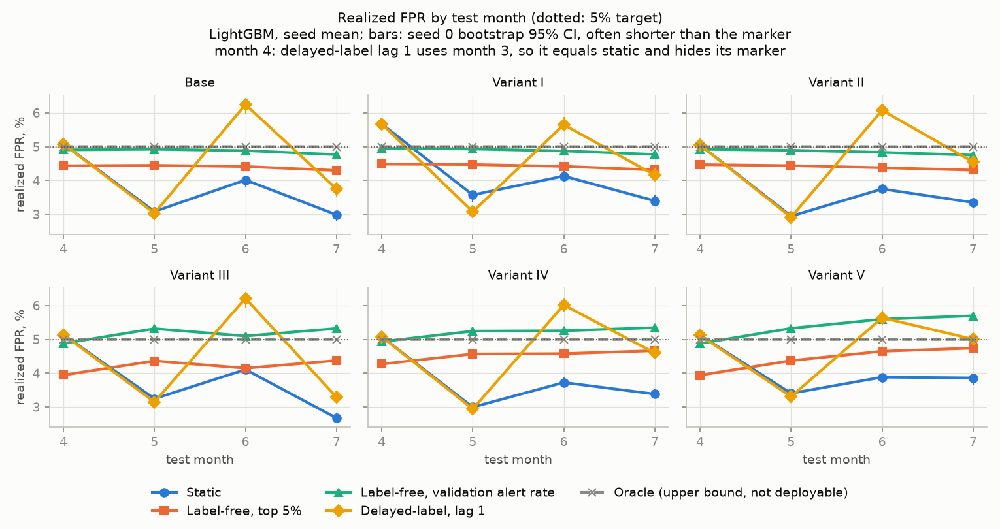
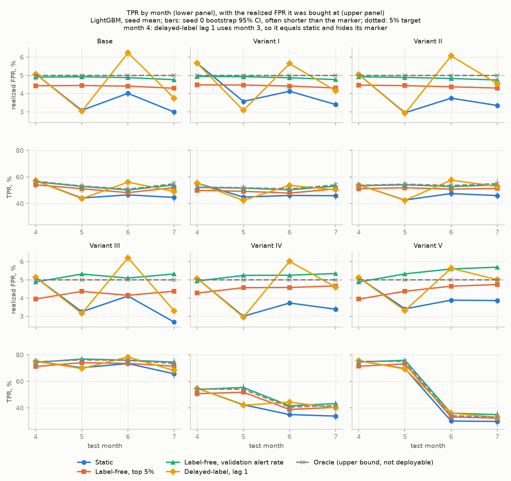
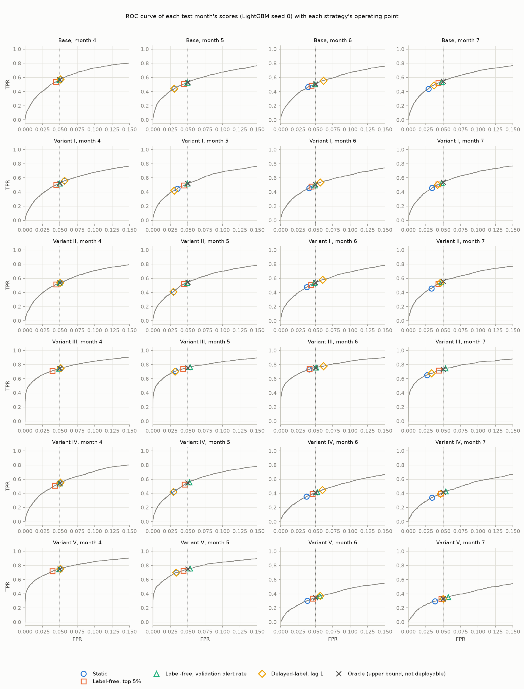
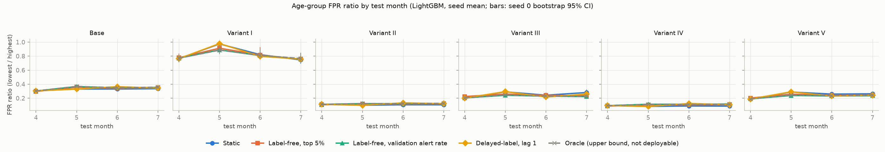

# Results

## Amendment 2026-10-17

This amendment corrects one claim, after post hoc analyses (RESULTS_POSTHOC.md) declared after the results below were seen, and one interpretive sentence, after claims audits. No number in `results/` has changed.

Original claim, as published at commit `125042c`. README.md: "On all six BAF variants, a LightGBM threshold set once on month 3 at 5% FPR under-spends its budget in months 5 to 7 by 0.87 to 2.32 points of FPR." reports/one_pager.md: "Finding 1: the static threshold under-spends, and label-free recalibration to the validation alert rate holds the budget best."

Post hoc evidence (RESULTS_POSTHOC.md section 1; results_posthoc/rolling_summary.csv and rolling_ci.csv). Split A, trained on months 0 and 1 with the threshold set on month 2: static is over budget in every test month of every variant (six variants sharing one base dataset), by 0.33 to 5.82 points, and 18 of 18 seed 0 intervals for months 5 to 7 lie entirely above zero. Split B, trained on months 0 to 3 with the threshold set on month 4: static is under budget in months 5 to 7 by 0.58 to 2.23 points, with 18 of 18 intervals below zero. The main split, trained on months 0 to 2 with the threshold set on month 3, gives the under-spend reported below (18 of 18 intervals below zero).

Corrected claim: a threshold set once at 5% FPR misses its budget in later months (months 5 to 7 on the main split), and the direction depends on the validation month: under-spend in months 5 to 7 when it is set on month 3 or 4, over-spend when it is set on month 2 (trained on months 0 and 1).

The three splits also change the training window (months 0 to 1, 0 to 2 and 0 to 3), so they do not by themselves separate the validation month from the training window; RESULTS_POSTHOC.md section 8 holds the model fixed to test the validation month alone.

Second correction. Original sentence in section 1 below: "`credit_risk_score` drifts most in every variant from month 3 on, which is consistent with the score drift behind the static budget misses below." Corrected, after a later claims audit found that this feature is the largest only in two variants: Among the ten most important features (results/psi.csv), `velocity_4w` has the largest population stability index in Base and Variants II, III and IV from month 3 on (3.35 to 5.09), and `credit_risk_score` in Variants I and V (0.20 to 0.53); replacing either feature alone leaves most of the static miss in place (RESULTS_POSTHOC.md section 2). The corrected sentence of the first version of this amendment, which said "in every variant", was itself wrong.

All numbers below are generated by `src/trace.py` from the files in `results/`, produced by `make all` at predictions commit `0be4b0ddf844b12493d29d3585329fa792f203ab`. Nothing is typed by hand; `make check` fails if a number does not trace to a results file or the run manifest.

How to read this file. The primary comparison is the budget miss, realized FPR minus the 5% target. TPR is always shown next to the realized FPR it was bought at, because every strategy applies a threshold to the same scores of the same month and so sits on that month's ROC curve. The oracle sets its threshold on the test month's own labels; it is an upper bound, not deployable. Seed spread (5 seeds) and bootstrap intervals (1,000 paired resamples of applications within a month, seed 0) are reported separately. A difference is called "differs" only if its paired 95% interval excludes 0 and the two marginal intervals overlap by less than half the shorter one; otherwise it is "inconclusive". Unless stated, numbers are LightGBM, 5% FPR target, older group `customer_age >= 50`, test months 4 to 7, with the model trained on months 0 to 2 and the static threshold set on month 3.

## 1. Checks

Audit. All six files have 1,000,000 rows, months 0 to 7, the expected columns and no row in more than one split (reports/data_audit.md). The older group is defined as `customer_age >= 50` because its group sizes match Table 1 of the paper to within 1.24 points on average, against 30.66 points for `> 50`.

Replication of the paper's setup on Base (train months 0 to 5, test months 6 and 7, threshold from the notebook's ROC rule on the pooled test labels, 20 configurations).

| check | with_month | n_configs | best_tpr | top5_mean_tpr | top5_mean_fpr_ratio | median_tpr | figure1_top5_tpr_by_eye | bound_lo | bound_hi | within_bound |
|---|---|---|---|---|---|---|---|---|---|---|
| replication | False | 20 | 0.5514 | 0.5468 | 0.3289 | 0.5308 | 0.5500 | 0.5000 | 0.6000 | True |
| replication | True | 20 | 0.5563 | 0.5520 | 0.3387 | 0.5342 | 0.5500 | 0.5000 | 0.6000 | True |

With `month` as a feature, as in the paper's code, the mean TPR of the 5 best configurations is 0.552 with FPR ratio 0.339, inside the loose bound of 0.5 to 0.6 around the Figure 1 reading; without `month` it is 0.547.

Shuffled-label check: FAILED. A LightGBM model trained on Base with labels shuffled within months 0 to 2 reached a pooled TPR of 0.117 at 5% FPR on months 4 to 7, outside the declared 0.05 plus or minus 0.02. The tripwire fired and the criterion was not redefined.

| check | months | positives | oracle_tpr_at_5pct_fpr | static_realized_fpr | static_tpr |
|---|---|---|---|---|---|
| shuffled labels | 4 | 1452 | 0.1136 | 0.0739 | 0.1377 |
| shuffled labels | 5 | 1411 | 0.1155 | 0.1706 | 0.2743 |
| shuffled labels | 6 | 1450 | 0.1041 | 0.2079 | 0.2979 |
| shuffled labels | 7 | 1428 | 0.1239 | 0.2327 | 0.3242 |
| shuffled labels | 4-7 pooled | 5741 | 0.1172 | 0.1655 | 0.2581 |

Post hoc, added after the tripwire fired, with no pass/fail threshold: 20 shuffles on the same split, next to the real-label models and a label-free density score (the norm of the standardized features).

| model | min | median | max | n_shuffles | real_label_tpr_at_5pct_fpr | density_score_tpr_at_5pct_fpr |
|---|---|---|---|---|---|---|
| lightgbm | 0.0422 | 0.0589 | 0.1172 | 20 | 0.5262 | 0.0827 |
| logreg | 0.0256 | 0.0406 | 0.0690 | 20 | 0.5119 | 0.0827 |

The original shuffle was the most extreme of the 20 for LightGBM (median 0.059, maximum 0.117); logistic regression ranged from 0.026 to 0.069, and the density score alone reached 0.083. The diagnostics found no leak: no label or month column among the features, a unit test confirms that every fitted preprocessing step and model fit uses training months only, and the univariate leak audit below flags 0 features (largest AUC 0.732). One possible explanation is a wrong null hypothesis: fraud applications are atypical, so a model fitted to random labels can exceed 5% TPR at 5% FPR. The median of the 20 shuffles was inside the tolerance and the failing run was the maximum, so the cause is not established. It stays a caveat on every result below.

Univariate leak audit, ten features furthest from AUC 0.5 per variant, on training months 0 to 2 and test months 4 to 7 (flag for review: above 0.75 or below 0.25).

| variant | feature | auc_train_months | auc_test_months | distance_from_half | flag_for_review | rank |
|---|---|---|---|---|---|---|
| Base | housing_status | 0.7040 | 0.7319 | 0.2319 | False | 1 |
| Base | device_os | 0.6782 | 0.6799 | 0.1799 | False | 2 |
| Base | credit_risk_score | 0.6412 | 0.6739 | 0.1739 | False | 3 |
| Base | customer_age | 0.6588 | 0.6496 | 0.1588 | False | 4 |
| Base | proposed_credit_limit | 0.6183 | 0.6470 | 0.1470 | False | 5 |
| Base | income | 0.6272 | 0.6351 | 0.1351 | False | 6 |
| Base | date_of_birth_distinct_emails_4w | 0.3721 | 0.3902 | 0.1279 | False | 7 |
| Base | current_address_months_count | 0.6235 | 0.6262 | 0.1262 | False | 8 |
| Base | keep_alive_session | 0.3823 | 0.3810 | 0.1190 | False | 9 |
| Base | name_email_similarity | 0.4064 | 0.3933 | 0.1067 | False | 10 |
| Variant I | housing_status | 0.6818 | 0.7148 | 0.2148 | False | 1 |
| Variant I | device_os | 0.6621 | 0.6712 | 0.1712 | False | 2 |
| Variant I | credit_risk_score | 0.6160 | 0.6703 | 0.1703 | False | 3 |
| Variant I | proposed_credit_limit | 0.5986 | 0.6386 | 0.1386 | False | 4 |
| Variant I | income | 0.6240 | 0.6331 | 0.1331 | False | 5 |
| Variant I | phone_home_valid | 0.4216 | 0.3883 | 0.1117 | False | 6 |
| Variant I | keep_alive_session | 0.3903 | 0.3892 | 0.1108 | False | 7 |
| Variant I | current_address_months_count | 0.5986 | 0.6071 | 0.1071 | False | 8 |
| Variant I | payment_type | 0.5842 | 0.6063 | 0.1063 | False | 9 |
| Variant I | bank_branch_count_8w | 0.4273 | 0.4026 | 0.0974 | False | 10 |
| Variant II | housing_status | 0.7154 | 0.7245 | 0.2245 | False | 1 |
| Variant II | customer_age | 0.7004 | 0.6992 | 0.2004 | False | 2 |
| Variant II | credit_risk_score | 0.6669 | 0.6896 | 0.1896 | False | 3 |
| Variant II | device_os | 0.6764 | 0.6853 | 0.1853 | False | 4 |
| Variant II | date_of_birth_distinct_emails_4w | 0.3265 | 0.3514 | 0.1735 | False | 5 |
| Variant II | proposed_credit_limit | 0.6412 | 0.6624 | 0.1624 | False | 6 |
| Variant II | current_address_months_count | 0.6279 | 0.6212 | 0.1279 | False | 7 |
| Variant II | income | 0.6264 | 0.6240 | 0.1264 | False | 8 |
| Variant II | keep_alive_session | 0.3832 | 0.3800 | 0.1200 | False | 9 |
| Variant II | employment_status | 0.6038 | 0.5777 | 0.1038 | False | 10 |
| Variant III | x1 | 0.7223 | 0.7320 | 0.2320 | False | 1 |
| Variant III | x2 | 0.7192 | 0.7268 | 0.2268 | False | 2 |
| Variant III | housing_status | 0.6840 | 0.7084 | 0.2084 | False | 3 |
| Variant III | device_os | 0.6644 | 0.6731 | 0.1731 | False | 4 |
| Variant III | credit_risk_score | 0.6310 | 0.6682 | 0.1682 | False | 5 |
| Variant III | proposed_credit_limit | 0.6140 | 0.6435 | 0.1435 | False | 6 |
| Variant III | phone_home_valid | 0.4132 | 0.3762 | 0.1238 | False | 7 |
| Variant III | income | 0.6212 | 0.6187 | 0.1212 | False | 8 |
| Variant III | keep_alive_session | 0.3933 | 0.3839 | 0.1161 | False | 9 |
| Variant III | payment_type | 0.5834 | 0.6089 | 0.1089 | False | 10 |
| Variant IV | housing_status | 0.7149 | 0.7131 | 0.2149 | False | 1 |
| Variant IV | customer_age | 0.6990 | 0.6277 | 0.1990 | False | 2 |
| Variant IV | device_os | 0.6806 | 0.6812 | 0.1812 | False | 3 |
| Variant IV | credit_risk_score | 0.6688 | 0.6809 | 0.1809 | False | 4 |
| Variant IV | date_of_birth_distinct_emails_4w | 0.3275 | 0.4014 | 0.1725 | False | 5 |
| Variant IV | proposed_credit_limit | 0.6414 | 0.6564 | 0.1564 | False | 6 |
| Variant IV | current_address_months_count | 0.6279 | 0.6093 | 0.1279 | False | 7 |
| Variant IV | income | 0.6251 | 0.6235 | 0.1251 | False | 8 |
| Variant IV | keep_alive_session | 0.3857 | 0.3786 | 0.1214 | False | 9 |
| Variant IV | phone_home_valid | 0.4354 | 0.3868 | 0.1132 | False | 10 |
| Variant V | x2 | 0.7277 | 0.6231 | 0.2277 | False | 1 |
| Variant V | x1 | 0.7226 | 0.6310 | 0.2226 | False | 2 |
| Variant V | housing_status | 0.6875 | 0.7080 | 0.2080 | False | 3 |
| Variant V | device_os | 0.6690 | 0.6778 | 0.1778 | False | 4 |
| Variant V | credit_risk_score | 0.6256 | 0.6714 | 0.1714 | False | 5 |
| Variant V | proposed_credit_limit | 0.6081 | 0.6476 | 0.1476 | False | 6 |
| Variant V | phone_home_valid | 0.4085 | 0.3725 | 0.1275 | False | 7 |
| Variant V | income | 0.6237 | 0.6151 | 0.1237 | False | 8 |
| Variant V | keep_alive_session | 0.3859 | 0.3773 | 0.1227 | False | 9 |
| Variant V | bank_branch_count_8w | 0.4273 | 0.3937 | 0.1063 | False | 10 |

No feature is flagged; the strongest single features are the injected `x1` and `x2` in Variants III and V, whose test-month AUC falls in Variant V after the bias is removed.

Independent check. A separate agent that had not seen the code recomputed the metrics from the saved scores with its own implementation.

| check | rows_compared | metrics | max_abs_diff | mismatches | median_ratio | min_ratio | max_ratio | rows_differing | max_abs_diff_tpr | max_abs_diff_realized_fpr | max_abs_diff_fpr_ratio |
|---|---|---|---|---|---|---|---|---|---|---|---|
| point metrics recomputed | 1200 | 10.0000 | 0.0000 | 0.0000 | nan | nan | nan | nan | nan | nan | nan |
| bootstrap width ratio, budget miss (checker / stored) | 48 | 1.0000 | nan | 0.0000 | 1.0042 | 0.8833 | 1.0971 | nan | nan | nan | nan |
| threshold at lowest flagged score (sensitivity) | 1200 | nan | nan | nan | nan | nan | nan | 217.0000 | 0.0014 | 0.0001 | 0.0025 |

All recomputed values match exactly, its own bootstrap widths agree with the stored ones to within about 12% (ratio 0.883 to 1.097), and placing thresholds at the lowest flagged score instead of just above the highest unflagged one changes static and delayed-label TPR by at most 0.00142.

Population stability index of the ten most important features (tuned LightGBM, seed 0) against training months 0 to 2.

| variant | importance_source | rank | feature | psi_month_0 | psi_month_1 | psi_month_2 | psi_month_3 | psi_month_4 | psi_month_5 | psi_month_6 | psi_month_7 |
|---|---|---|---|---|---|---|---|---|---|---|---|
| Base | tuned | 1 | housing_status | 0.0406 | 0.0161 | 0.0273 | 0.0783 | 0.0334 | 0.0185 | 0.0559 | 0.0699 |
| Base | tuned | 2 | device_os | 0.0177 | 0.0028 | 0.0078 | 0.0119 | 0.0363 | 0.0305 | 0.0464 | 0.0041 |
| Base | tuned | 3 | credit_risk_score | 0.0239 | 0.0148 | 0.0173 | 0.2869 | 0.2254 | 0.3363 | 0.4820 | 0.5066 |
| Base | tuned | 4 | name_email_similarity | 0.0369 | 0.0064 | 0.0206 | 0.0370 | 0.0481 | 0.1969 | 0.1680 | 0.0278 |
| Base | tuned | 5 | current_address_months_count | 0.0109 | 0.0236 | 0.0149 | 0.0220 | 0.0049 | 0.0837 | 0.0314 | 0.0959 |
| Base | tuned | 6 | prev_address_months_count | 0.0029 | 0.0164 | 0.0104 | 0.0212 | 0.0116 | 0.1097 | 0.0529 | 0.0543 |
| Base | tuned | 7 | income | 0.0076 | 0.0001 | 0.0069 | 0.0230 | 0.0451 | 0.0425 | 0.1412 | 0.1188 |
| Base | tuned | 8 | velocity_4w | 1.9015 | 0.8567 | 1.1476 | 3.6839 | 4.3805 | 5.0297 | 5.0870 | 4.5923 |
| Base | tuned | 9 | phone_home_valid | 0.0009 | 0.0026 | 0.0060 | 0.0114 | 0.0000 | 0.0478 | 0.0100 | 0.0298 |
| Base | tuned | 10 | date_of_birth_distinct_emails_4w | 0.0566 | 0.0091 | 0.0249 | 0.1106 | 0.2006 | 0.3760 | 0.5697 | 0.8024 |
| Variant I | tuned | 1 | housing_status | 0.0405 | 0.0173 | 0.0284 | 0.0855 | 0.0365 | 0.0234 | 0.0569 | 0.0851 |
| Variant I | tuned | 2 | device_os | 0.0177 | 0.0032 | 0.0074 | 0.0110 | 0.0318 | 0.0301 | 0.0477 | 0.0025 |
| Variant I | tuned | 3 | name_email_similarity | 0.0385 | 0.0065 | 0.0211 | 0.0380 | 0.0450 | 0.1995 | 0.1708 | 0.0285 |
| Variant I | tuned | 4 | credit_risk_score | 0.0255 | 0.0155 | 0.0188 | 0.3000 | 0.2286 | 0.3609 | 0.4913 | 0.5293 |
| Variant I | tuned | 5 | current_address_months_count | 0.0114 | 0.0268 | 0.0163 | 0.0240 | 0.0065 | 0.0926 | 0.0375 | 0.0895 |
| Variant I | tuned | 6 | prev_address_months_count | 0.0034 | 0.0183 | 0.0116 | 0.0240 | 0.0147 | 0.1156 | 0.0597 | 0.0547 |
| Variant I | tuned | 7 | phone_home_valid | 0.0010 | 0.0031 | 0.0070 | 0.0129 | 0.0000 | 0.0533 | 0.0108 | 0.0404 |
| Variant I | tuned | 8 | income | 0.0077 | 0.0001 | 0.0067 | 0.0216 | 0.0421 | 0.0400 | 0.1321 | 0.1262 |
| Variant I | tuned | 9 | has_other_cards | 0.0012 | 0.0035 | 0.0006 | 0.0426 | 0.0209 | 0.0458 | 0.0165 | 0.0011 |
| Variant I | tuned | 10 | keep_alive_session | 0.0205 | 0.0015 | 0.0097 | 0.0336 | 0.0697 | 0.0014 | 0.0052 | 0.0058 |
| Variant II | tuned | 1 | housing_status | 0.0478 | 0.0165 | 0.0274 | 0.0686 | 0.0332 | 0.0121 | 0.0399 | 0.0633 |
| Variant II | tuned | 2 | customer_age | 0.0108 | 0.0022 | 0.0044 | 0.0127 | 0.0047 | 0.0090 | 0.0148 | 0.0202 |
| Variant II | tuned | 3 | credit_risk_score | 0.0220 | 0.0137 | 0.0175 | 0.2407 | 0.1949 | 0.3061 | 0.4319 | 0.4613 |
| Variant II | tuned | 4 | device_os | 0.0168 | 0.0033 | 0.0066 | 0.0138 | 0.0365 | 0.0244 | 0.0368 | 0.0030 |
| Variant II | tuned | 5 | name_email_similarity | 0.0349 | 0.0061 | 0.0181 | 0.0384 | 0.0479 | 0.1956 | 0.1568 | 0.0203 |
| Variant II | tuned | 6 | current_address_months_count | 0.0150 | 0.0218 | 0.0161 | 0.0147 | 0.0047 | 0.0796 | 0.0308 | 0.0805 |
| Variant II | tuned | 7 | days_since_request | 0.0270 | 0.0060 | 0.0083 | 0.0141 | 0.0081 | 0.0433 | 0.0278 | 0.0407 |
| Variant II | tuned | 8 | date_of_birth_distinct_emails_4w | 0.0562 | 0.0109 | 0.0244 | 0.0850 | 0.1457 | 0.2728 | 0.3709 | 0.5757 |
| Variant II | tuned | 9 | session_length_in_minutes | 0.0083 | 0.0104 | 0.0178 | 0.0320 | 0.0572 | 0.1550 | 0.0642 | 0.1534 |
| Variant II | tuned | 10 | velocity_4w | 1.9030 | 0.8657 | 1.1436 | 3.5635 | 4.3035 | 4.9729 | 4.9777 | 4.3871 |
| Variant III | tuned | 1 | x1 | 0.0001 | 0.0001 | 0.0001 | 0.0001 | 0.0002 | 0.0001 | 0.0001 | 0.0001 |
| Variant III | tuned | 2 | x2 | 0.0001 | 0.0000 | 0.0000 | 0.0001 | 0.0001 | 0.0001 | 0.0002 | 0.0000 |
| Variant III | tuned | 3 | customer_age | 0.0140 | 0.0014 | 0.0027 | 0.0118 | 0.0062 | 0.0103 | 0.0155 | 0.0192 |
| Variant III | tuned | 4 | housing_status | 0.0613 | 0.0145 | 0.0187 | 0.0745 | 0.0423 | 0.0132 | 0.0399 | 0.0681 |
| Variant III | tuned | 5 | device_os | 0.0231 | 0.0017 | 0.0041 | 0.0156 | 0.0387 | 0.0290 | 0.0436 | 0.0033 |
| Variant III | tuned | 6 | credit_risk_score | 0.0299 | 0.0142 | 0.0124 | 0.2510 | 0.2006 | 0.3088 | 0.4351 | 0.4565 |
| Variant III | tuned | 7 | current_address_months_count | 0.0197 | 0.0225 | 0.0125 | 0.0150 | 0.0051 | 0.0774 | 0.0314 | 0.0839 |
| Variant III | tuned | 8 | name_email_similarity | 0.0466 | 0.0045 | 0.0117 | 0.0404 | 0.0495 | 0.1965 | 0.1576 | 0.0218 |
| Variant III | tuned | 9 | velocity_4w | 2.4372 | 0.5752 | 0.6543 | 3.3538 | 4.2466 | 4.9506 | 4.9468 | 4.3579 |
| Variant III | tuned | 10 | session_length_in_minutes | 0.0110 | 0.0123 | 0.0130 | 0.0365 | 0.0634 | 0.1622 | 0.0700 | 0.1613 |
| Variant IV | tuned | 1 | housing_status | 0.0617 | 0.0144 | 0.0187 | 0.0741 | 0.0421 | 0.0133 | 0.0400 | 0.0682 |
| Variant IV | tuned | 2 | customer_age | 0.0142 | 0.0014 | 0.0027 | 0.0115 | 0.0062 | 0.0103 | 0.0157 | 0.0194 |
| Variant IV | tuned | 3 | device_os | 0.0231 | 0.0017 | 0.0041 | 0.0157 | 0.0386 | 0.0291 | 0.0435 | 0.0032 |
| Variant IV | tuned | 4 | credit_risk_score | 0.0298 | 0.0142 | 0.0124 | 0.2506 | 0.2005 | 0.3084 | 0.4351 | 0.4565 |
| Variant IV | tuned | 5 | name_email_similarity | 0.0467 | 0.0045 | 0.0117 | 0.0402 | 0.0497 | 0.1966 | 0.1579 | 0.0218 |
| Variant IV | tuned | 6 | current_address_months_count | 0.0197 | 0.0225 | 0.0124 | 0.0152 | 0.0050 | 0.0776 | 0.0315 | 0.0837 |
| Variant IV | tuned | 7 | date_of_birth_distinct_emails_4w | 0.0535 | 0.0046 | 0.0119 | 0.0816 | 0.1417 | 0.2594 | 0.3552 | 0.5477 |
| Variant IV | tuned | 8 | phone_home_valid | 0.0002 | 0.0039 | 0.0029 | 0.0086 | 0.0001 | 0.0429 | 0.0058 | 0.0313 |
| Variant IV | tuned | 9 | has_other_cards | 0.0008 | 0.0051 | 0.0015 | 0.0318 | 0.0177 | 0.0477 | 0.0207 | 0.0023 |
| Variant IV | tuned | 10 | velocity_4w | 2.4376 | 0.5750 | 0.6541 | 3.3555 | 4.2474 | 4.9503 | 4.9468 | 4.3578 |
| Variant V | tuned | 1 | x1 | 0.0001 | 0.0001 | 0.0001 | 0.0001 | 0.0002 | 0.0001 | 0.0003 | 0.0003 |
| Variant V | tuned | 2 | x2 | 0.0001 | 0.0000 | 0.0000 | 0.0001 | 0.0001 | 0.0001 | 0.0004 | 0.0001 |
| Variant V | tuned | 3 | customer_age | 0.0141 | 0.0013 | 0.0031 | 0.0111 | 0.0059 | 0.0109 | 0.0169 | 0.0178 |
| Variant V | tuned | 4 | housing_status | 0.0617 | 0.0156 | 0.0184 | 0.0697 | 0.0405 | 0.0136 | 0.0390 | 0.0654 |
| Variant V | tuned | 5 | device_os | 0.0207 | 0.0010 | 0.0042 | 0.0160 | 0.0371 | 0.0293 | 0.0446 | 0.0041 |
| Variant V | tuned | 6 | credit_risk_score | 0.0298 | 0.0138 | 0.0121 | 0.2474 | 0.2032 | 0.3063 | 0.4294 | 0.4521 |
| Variant V | tuned | 7 | name_email_similarity | 0.0443 | 0.0045 | 0.0115 | 0.0380 | 0.0514 | 0.1944 | 0.1550 | 0.0215 |
| Variant V | tuned | 8 | current_address_months_count | 0.0183 | 0.0217 | 0.0130 | 0.0148 | 0.0055 | 0.0788 | 0.0316 | 0.0831 |
| Variant V | tuned | 9 | keep_alive_session | 0.0260 | 0.0002 | 0.0062 | 0.0208 | 0.0529 | 0.0000 | 0.0014 | 0.0136 |
| Variant V | tuned | 10 | prev_address_months_count | 0.0027 | 0.0156 | 0.0067 | 0.0124 | 0.0120 | 0.0859 | 0.0423 | 0.0409 |

Among the ten most important features (results/psi.csv), `velocity_4w` has the largest population stability index in Base and Variants II, III and IV from month 3 on (3.35 to 5.09), and `credit_risk_score` in Variants I and V (0.20 to 0.53); replacing either feature alone leaves most of the static miss in place (RESULTS_POSTHOC.md section 2), post hoc; no drifting feature has been shown to produce the misses.

Bootstrap diagnostic: in 6 of 21,384 interval rows the point estimate lies outside its percentile interval, likely because thresholds are re-estimated inside each resample.

## 2. Budget miss (primary result)

Signed budget miss in percentage points, seed mean, with the paired verdict of each deployable strategy against static on absolute miss (seed 0).

| Variant | Month | Static, budget miss pt | Label-free, top 5%, budget miss pt | Label-free, validation alert rate, budget miss pt | Delayed-label, lag 1, budget miss pt | Oracle (upper bound, not deployable), budget miss pt | Label-free, top 5% vs static, absolute miss | Label-free, validation alert rate vs static, absolute miss | Delayed-label, lag 1 vs static, absolute miss |
|---|---|---|---|---|---|---|---|---|---|
| Base | 4 | +0.08 | -0.57 | -0.10 | +0.08 | -0.00 | differs | inconclusive | inconclusive |
| Base | 5 | -1.92 | -0.55 | -0.08 | -1.97 | -0.00 | differs | differs | inconclusive |
| Base | 6 | -0.98 | -0.59 | -0.12 | +1.24 | -0.00 | differs | differs | inconclusive |
| Base | 7 | -2.01 | -0.70 | -0.24 | -1.25 | -0.00 | differs | differs | differs |
| Variant I | 4 | +0.67 | -0.52 | -0.05 | +0.67 | -0.00 | inconclusive | differs | inconclusive |
| Variant I | 5 | -1.43 | -0.53 | -0.07 | -1.92 | -0.00 | differs | differs | differs |
| Variant I | 6 | -0.87 | -0.58 | -0.13 | +0.65 | -0.00 | differs | differs | inconclusive |
| Variant I | 7 | -1.60 | -0.69 | -0.23 | -0.84 | -0.00 | differs | differs | differs |
| Variant II | 4 | +0.05 | -0.53 | -0.08 | +0.05 | -0.00 | differs | inconclusive | inconclusive |
| Variant II | 5 | -2.05 | -0.56 | -0.11 | -2.09 | -0.00 | differs | differs | inconclusive |
| Variant II | 6 | -1.25 | -0.62 | -0.17 | +1.08 | -0.00 | differs | differs | inconclusive |
| Variant II | 7 | -1.65 | -0.69 | -0.25 | -0.45 | -0.00 | differs | differs | differs |
| Variant III | 4 | +0.14 | -1.05 | -0.12 | +0.14 | -0.00 | differs | inconclusive | inconclusive |
| Variant III | 5 | -1.75 | -0.64 | +0.32 | -1.85 | -0.00 | differs | differs | inconclusive |
| Variant III | 6 | -0.89 | -0.85 | +0.10 | +1.21 | -0.00 | inconclusive | differs | inconclusive |
| Variant III | 7 | -2.32 | -0.63 | +0.32 | -1.71 | -0.00 | differs | differs | differs |
| Variant IV | 4 | +0.08 | -0.73 | -0.07 | +0.08 | -0.00 | differs | inconclusive | inconclusive |
| Variant IV | 5 | -2.00 | -0.43 | +0.25 | -2.05 | -0.00 | differs | differs | inconclusive |
| Variant IV | 6 | -1.27 | -0.42 | +0.26 | +1.02 | -0.00 | differs | differs | differs |
| Variant IV | 7 | -1.62 | -0.33 | +0.35 | -0.40 | -0.00 | differs | differs | differs |
| Variant V | 4 | +0.12 | -1.06 | -0.12 | +0.12 | -0.00 | differs | inconclusive | inconclusive |
| Variant V | 5 | -1.59 | -0.63 | +0.33 | -1.69 | -0.00 | differs | differs | inconclusive |
| Variant V | 6 | -1.12 | -0.35 | +0.60 | +0.64 | -0.00 | differs | differs | differs |
| Variant V | 7 | -1.14 | -0.26 | +0.70 | +0.01 | -0.00 | differs | differs | differs |

With the threshold set on month 3, static is within 0.67 points of budget in month 4 but under budget by 0.87 to 2.32 points in months 5 to 7 in every variant (18 of 18 seed 0 intervals entirely below zero; those intervals are 0.23 to 0.32 points wide and the largest seed standard deviation is 0.16 points; six variants sharing one base); label-free at the validation alert rate is within 0.5 points in 22 of 24 variant-months and has the smallest absolute miss of the deployable strategies in 18.

Label-free top 5% sits 0.26 to 1.06 points under budget in every variant-month because frauds take part of a fixed 5% of alerts, and delayed-label lag 1 swings from -2.09 to +1.24 points, consistent with month-to-month score shifts that do not persist.

Against static on absolute budget miss, label-free at the validation alert rate is smaller in 19 variant-months, inconclusive in 5 and larger in 0; delayed-label lag 1 is smaller in 8, inconclusive in 15 and larger in 1.

The validation-rate strategy is slightly under budget in every month of Base, I and II and slightly over in months 5 to 7 of III, IV and V; the two groups of variants share different monthly fraud-rate profiles (reports/data_audit.md), and a fixed alert share turns a lower fraud rate into more flagged negatives, as in the synthetic mechanism study (reports/mechanism.md).

## 3. Per-variant results: realized FPR and TPR together

Base.

| Strategy | Month | Realized FPR %, seed mean (sd; min to max) | Budget miss pt, seed 0 [95% CI] | TPR %, seed mean (sd; min to max) | TPR %, seed 0 [95% CI] | Alert volume %, seed mean | Precision %, seed mean |
|---|---|---|---|---|---|---|---|
| Static | 4 | 5.08 (0.02; 5.05 to 5.10) | +0.05 [-0.11, +0.22] | 57.2 (0.1; 57.0 to 57.4) | 57.2 [54.5, 60.0] | 5.67 | 11.5 |
| Static | 5 | 3.08 (0.02; 3.06 to 3.10) | -1.90 [-2.02, -1.78] | 44.2 (0.2; 43.8 to 44.4) | 44.4 [41.7, 46.6] | 3.57 | 14.6 |
| Static | 6 | 4.02 (0.04; 3.96 to 4.05) | -1.04 [-1.20, -0.89] | 46.6 (0.3; 46.1 to 46.9) | 46.5 [43.9, 49.1] | 4.59 | 13.6 |
| Static | 7 | 2.99 (0.08; 2.90 to 3.11) | -2.10 [-2.21, -1.97] | 44.7 (0.9; 43.8 to 46.1) | 43.8 [41.3, 46.5] | 3.60 | 18.3 |
| Label-free, top 5% | 4 | 4.43 (0.00; 4.43 to 4.44) | -0.56 [-0.60, -0.52] | 54.1 (0.4; 53.6 to 54.5) | 53.6 [51.3, 56.1] | 5.00 | 12.3 |
| Label-free, top 5% | 5 | 4.45 (0.01; 4.44 to 4.45) | -0.55 [-0.59, -0.51] | 51.2 (0.4; 50.7 to 51.8) | 50.7 [48.3, 53.0] | 5.00 | 12.1 |
| Label-free, top 5% | 6 | 4.41 (0.01; 4.41 to 4.42) | -0.59 [-0.63, -0.54] | 48.2 (0.5; 47.4 to 48.6) | 48.3 [45.7, 50.7] | 5.00 | 12.9 |
| Label-free, top 5% | 7 | 4.30 (0.01; 4.29 to 4.30) | -0.70 [-0.76, -0.65] | 52.0 (0.4; 51.7 to 52.6) | 52.0 [49.6, 54.5] | 5.00 | 15.3 |
| Label-free, validation alert rate | 4 | 4.90 (0.00; 4.90 to 4.91) | -0.09 [-0.14, -0.04] | 56.4 (0.2; 56.1 to 56.6) | 56.2 [53.7, 58.7] | 5.49 | 11.7 |
| Label-free, validation alert rate | 5 | 4.92 (0.00; 4.92 to 4.93) | -0.08 [-0.13, -0.02] | 52.9 (0.3; 52.5 to 53.4) | 52.8 [50.4, 55.1] | 5.49 | 11.4 |
| Label-free, validation alert rate | 6 | 4.88 (0.00; 4.88 to 4.89) | -0.12 [-0.17, -0.06] | 50.2 (0.3; 49.9 to 50.8) | 50.2 [47.6, 52.5] | 5.49 | 12.3 |
| Label-free, validation alert rate | 7 | 4.76 (0.01; 4.76 to 4.77) | -0.23 [-0.30, -0.17] | 54.0 (0.5; 53.4 to 54.6) | 53.9 [51.4, 56.3] | 5.49 | 14.5 |
| Delayed-label, lag 1 (equals static: source month 3) | 4 | 5.08 (0.02; 5.05 to 5.10) | +0.05 [-0.11, +0.22] | 57.2 (0.1; 57.0 to 57.4) | 57.2 [54.5, 60.0] | 5.67 | 11.5 |
| Delayed-label, lag 1 | 5 | 3.03 (0.03; 2.99 to 3.07) | -1.93 [-2.06, -1.80] | 43.7 (0.4; 43.2 to 44.1) | 44.1 [41.4, 46.5] | 3.51 | 14.7 |
| Delayed-label, lag 1 | 6 | 6.24 (0.05; 6.16 to 6.28) | +1.16 [+0.97, +1.36] | 56.1 (0.4; 55.6 to 56.6) | 55.6 [52.9, 58.0] | 6.91 | 10.9 |
| Delayed-label, lag 1 | 7 | 3.75 (0.09; 3.66 to 3.87) | -1.34 [-1.47, -1.16] | 49.0 (0.5; 48.6 to 49.9) | 49.0 [46.5, 51.7] | 4.42 | 16.4 |
| Oracle (upper bound, not deployable) | 4 | 5.00 (0.00; 5.00 to 5.00) | -0.00 [-0.00, +0.00] | 56.8 (0.1; 56.6 to 57.0) | 56.9 [54.1, 59.6] | 5.59 | 11.6 |
| Oracle (upper bound, not deployable) | 5 | 5.00 (0.00; 5.00 to 5.00) | -0.00 [-0.00, +0.00] | 53.2 (0.3; 52.9 to 53.5) | 53.2 [50.8, 55.7] | 5.57 | 11.3 |
| Oracle (upper bound, not deployable) | 6 | 5.00 (0.00; 5.00 to 5.00) | -0.00 [-0.00, +0.00] | 50.9 (0.2; 50.6 to 51.2) | 50.6 [48.0, 53.3] | 5.61 | 12.1 |
| Oracle (upper bound, not deployable) | 7 | 5.00 (0.00; 5.00 to 5.00) | -0.00 [-0.00, +0.00] | 54.9 (0.6; 54.3 to 55.5) | 54.6 [52.0, 57.2] | 5.74 | 14.1 |

In Base, static TPR falls with its realized FPR in months 5 to 7, and the oracle (upper bound) TPR moves from 55.0% in months 4 and 5 to 52.9% in months 6 and 7.

Variant I.

| Strategy | Month | Realized FPR %, seed mean (sd; min to max) | Budget miss pt, seed 0 [95% CI] | TPR %, seed mean (sd; min to max) | TPR %, seed 0 [95% CI] | Alert volume %, seed mean | Precision %, seed mean |
|---|---|---|---|---|---|---|---|
| Static | 4 | 5.67 (0.02; 5.64 to 5.69) | +0.65 [+0.47, +0.81] | 55.4 (0.6; 54.7 to 55.9) | 55.9 [53.2, 58.4] | 6.23 | 10.1 |
| Static | 5 | 3.57 (0.04; 3.51 to 3.61) | -1.49 [-1.62, -1.35] | 44.9 (0.4; 44.5 to 45.5) | 44.6 [42.0, 47.6] | 4.06 | 13.1 |
| Static | 6 | 4.13 (0.04; 4.08 to 4.17) | -0.88 [-1.04, -0.72] | 46.1 (0.6; 45.4 to 46.8) | 45.6 [43.0, 48.1] | 4.69 | 13.2 |
| Static | 7 | 3.40 (0.05; 3.34 to 3.48) | -1.59 [-1.72, -1.44] | 45.9 (0.7; 45.2 to 46.6) | 45.7 [42.9, 48.3] | 4.03 | 16.8 |
| Label-free, top 5% | 4 | 4.48 (0.00; 4.48 to 4.49) | -0.52 [-0.56, -0.48] | 49.9 (0.4; 49.5 to 50.5) | 50.1 [47.8, 52.6] | 5.00 | 11.4 |
| Label-free, top 5% | 5 | 4.47 (0.00; 4.47 to 4.47) | -0.53 [-0.57, -0.49] | 49.2 (0.2; 49.0 to 49.5) | 49.2 [46.7, 51.7] | 5.00 | 11.6 |
| Label-free, top 5% | 6 | 4.42 (0.01; 4.41 to 4.42) | -0.58 [-0.63, -0.54] | 47.9 (0.4; 47.3 to 48.3) | 47.9 [45.3, 50.4] | 5.00 | 12.8 |
| Label-free, top 5% | 7 | 4.31 (0.01; 4.30 to 4.32) | -0.69 [-0.74, -0.63] | 51.1 (0.4; 50.6 to 51.8) | 50.8 [48.4, 53.4] | 5.00 | 15.1 |
| Label-free, validation alert rate | 4 | 4.95 (0.01; 4.94 to 4.95) | -0.05 [-0.11, -0.00] | 52.1 (0.4; 51.8 to 52.8) | 52.1 [49.8, 54.7] | 5.48 | 10.8 |
| Label-free, validation alert rate | 5 | 4.93 (0.00; 4.93 to 4.93) | -0.07 [-0.12, -0.02] | 51.7 (0.3; 51.3 to 51.9) | 51.9 [49.3, 54.3] | 5.48 | 11.1 |
| Label-free, validation alert rate | 6 | 4.87 (0.01; 4.86 to 4.89) | -0.11 [-0.17, -0.06] | 50.4 (0.6; 49.4 to 51.1) | 49.4 [47.0, 52.0] | 5.48 | 12.3 |
| Label-free, validation alert rate | 7 | 4.77 (0.01; 4.76 to 4.78) | -0.22 [-0.28, -0.16] | 53.1 (0.4; 52.6 to 53.6) | 52.6 [50.1, 55.1] | 5.48 | 14.3 |
| Delayed-label, lag 1 (equals static: source month 3) | 4 | 5.67 (0.02; 5.64 to 5.69) | +0.65 [+0.47, +0.81] | 55.4 (0.6; 54.7 to 55.9) | 55.9 [53.2, 58.4] | 6.23 | 10.1 |
| Delayed-label, lag 1 | 5 | 3.08 (0.03; 3.05 to 3.11) | -1.95 [-2.07, -1.82] | 42.4 (0.4; 41.9 to 42.9) | 41.9 [39.3, 44.4] | 3.54 | 14.2 |
| Delayed-label, lag 1 | 6 | 5.65 (0.05; 5.59 to 5.69) | +0.69 [+0.49, +0.89] | 53.7 (0.2; 53.6 to 54.0) | 53.7 [50.7, 56.2] | 6.29 | 11.4 |
| Delayed-label, lag 1 | 7 | 4.16 (0.07; 4.06 to 4.26) | -0.82 [-0.99, -0.64] | 50.3 (0.4; 49.7 to 50.8) | 50.2 [47.3, 52.7] | 4.84 | 15.3 |
| Oracle (upper bound, not deployable) | 4 | 5.00 (0.00; 5.00 to 5.00) | -0.00 [-0.00, +0.00] | 52.4 (0.4; 52.1 to 53.1) | 52.5 [49.9, 55.1] | 5.54 | 10.8 |
| Oracle (upper bound, not deployable) | 5 | 5.00 (0.00; 5.00 to 5.00) | -0.00 [-0.00, +0.00] | 51.9 (0.2; 51.7 to 52.2) | 52.0 [49.4, 54.6] | 5.55 | 11.1 |
| Oracle (upper bound, not deployable) | 6 | 5.00 (0.00; 5.00 to 5.00) | -0.00 [-0.00, +0.00] | 51.0 (0.4; 50.3 to 51.5) | 50.3 [47.4, 52.9] | 5.62 | 12.2 |
| Oracle (upper bound, not deployable) | 7 | 5.00 (0.00; 5.00 to 5.00) | -0.00 [-0.00, +0.00] | 54.1 (0.3; 53.9 to 54.6) | 54.1 [51.1, 56.4] | 5.72 | 13.9 |

Variant I follows Base: static goes +0.67 points over budget in month 4 and under budget afterwards.

Variant II.

| Strategy | Month | Realized FPR %, seed mean (sd; min to max) | Budget miss pt, seed 0 [95% CI] | TPR %, seed mean (sd; min to max) | TPR %, seed 0 [95% CI] | Alert volume %, seed mean | Precision %, seed mean |
|---|---|---|---|---|---|---|---|
| Static | 4 | 5.05 (0.04; 5.01 to 5.11) | +0.01 [-0.16, +0.17] | 54.0 (0.5; 53.6 to 54.8) | 53.7 [51.1, 56.2] | 5.61 | 11.0 |
| Static | 5 | 2.95 (0.04; 2.90 to 3.00) | -2.04 [-2.16, -1.92] | 42.7 (0.9; 41.2 to 43.4) | 41.2 [38.7, 43.8] | 3.42 | 14.8 |
| Static | 6 | 3.75 (0.04; 3.68 to 3.78) | -1.26 [-1.40, -1.10] | 47.5 (0.7; 46.6 to 48.3) | 47.4 [44.9, 50.3] | 4.34 | 14.7 |
| Static | 7 | 3.35 (0.10; 3.19 to 3.44) | -1.67 [-1.83, -1.51] | 46.0 (0.4; 45.7 to 46.6) | 45.8 [43.2, 48.6] | 3.98 | 17.1 |
| Label-free, top 5% | 4 | 4.47 (0.01; 4.46 to 4.48) | -0.53 [-0.57, -0.50] | 51.2 (0.5; 50.6 to 51.8) | 51.4 [49.0, 53.8] | 5.00 | 11.6 |
| Label-free, top 5% | 5 | 4.44 (0.00; 4.43 to 4.44) | -0.56 [-0.60, -0.52] | 51.9 (0.3; 51.7 to 52.4) | 51.9 [49.3, 54.5] | 5.00 | 12.3 |
| Label-free, top 5% | 6 | 4.38 (0.01; 4.37 to 4.38) | -0.63 [-0.68, -0.58] | 50.9 (0.4; 50.5 to 51.3) | 51.2 [48.9, 53.8] | 5.00 | 13.6 |
| Label-free, top 5% | 7 | 4.31 (0.01; 4.29 to 4.31) | -0.71 [-0.76, -0.66] | 51.4 (0.6; 50.8 to 52.3) | 52.3 [49.9, 54.7] | 5.00 | 15.2 |
| Label-free, validation alert rate | 4 | 4.92 (0.01; 4.91 to 4.93) | -0.07 [-0.12, -0.02] | 53.4 (0.5; 52.8 to 54.3) | 53.3 [50.9, 55.6] | 5.47 | 11.1 |
| Label-free, validation alert rate | 5 | 4.89 (0.00; 4.89 to 4.90) | -0.10 [-0.16, -0.05] | 54.1 (0.4; 53.8 to 54.6) | 53.9 [51.4, 56.6] | 5.48 | 11.7 |
| Label-free, validation alert rate | 6 | 4.83 (0.01; 4.82 to 4.84) | -0.17 [-0.23, -0.12] | 52.8 (0.6; 52.1 to 53.7) | 53.2 [50.7, 55.9] | 5.47 | 12.9 |
| Label-free, validation alert rate | 7 | 4.75 (0.00; 4.74 to 4.75) | -0.26 [-0.32, -0.20] | 54.0 (0.3; 53.6 to 54.5) | 54.5 [52.1, 56.9] | 5.47 | 14.5 |
| Delayed-label, lag 1 (equals static: source month 3) | 4 | 5.05 (0.04; 5.01 to 5.11) | +0.01 [-0.16, +0.17] | 54.0 (0.5; 53.6 to 54.8) | 53.7 [51.1, 56.2] | 5.61 | 11.0 |
| Delayed-label, lag 1 | 5 | 2.91 (0.03; 2.88 to 2.95) | -2.05 [-2.17, -1.92] | 42.5 (0.7; 41.2 to 43.0) | 41.2 [38.6, 43.7] | 3.38 | 14.8 |
| Delayed-label, lag 1 | 6 | 6.08 (0.07; 6.01 to 6.19) | +1.03 [+0.81, +1.23] | 57.6 (0.4; 57.1 to 58.0) | 58.0 [55.4, 60.7] | 6.77 | 11.4 |
| Delayed-label, lag 1 | 7 | 4.55 (0.07; 4.44 to 4.63) | -0.44 [-0.63, -0.25] | 52.9 (0.5; 52.5 to 53.8) | 53.8 [51.2, 56.3] | 5.26 | 14.8 |
| Oracle (upper bound, not deployable) | 4 | 5.00 (0.00; 5.00 to 5.00) | -0.00 [-0.00, +0.00] | 53.8 (0.6; 53.0 to 54.6) | 53.7 [51.1, 56.1] | 5.55 | 11.0 |
| Oracle (upper bound, not deployable) | 5 | 5.00 (0.00; 5.00 to 5.00) | -0.00 [-0.00, +0.00] | 54.6 (0.4; 54.1 to 55.2) | 54.5 [51.8, 57.0] | 5.59 | 11.6 |
| Oracle (upper bound, not deployable) | 6 | 5.00 (0.00; 5.00 to 5.00) | -0.00 [-0.00, -0.00] | 53.6 (0.7; 52.8 to 54.5) | 53.9 [51.2, 56.7] | 5.65 | 12.7 |
| Oracle (upper bound, not deployable) | 7 | 5.00 (0.00; 5.00 to 5.00) | -0.00 [-0.00, +0.00] | 55.1 (0.4; 54.7 to 55.7) | 55.7 [53.2, 58.5] | 5.74 | 14.1 |

In Variant II, the largest TPR gap among static, label-free top 5% and delayed-label lag 1, in month 6, matches delayed-label lag 1 running +1.08 points over budget while static runs -1.25.

Variant III.

| Strategy | Month | Realized FPR %, seed mean (sd; min to max) | Budget miss pt, seed 0 [95% CI] | TPR %, seed mean (sd; min to max) | TPR %, seed 0 [95% CI] | Alert volume %, seed mean | Precision %, seed mean |
|---|---|---|---|---|---|---|---|
| Static | 4 | 5.14 (0.04; 5.10 to 5.18) | +0.12 [-0.05, +0.29] | 75.1 (0.3; 74.8 to 75.5) | 75.2 [73.3, 77.1] | 6.24 | 18.9 |
| Static | 5 | 3.25 (0.06; 3.18 to 3.33) | -1.73 [-1.85, -1.60] | 70.3 (0.4; 69.8 to 70.8) | 70.8 [68.3, 73.1] | 3.86 | 16.6 |
| Static | 6 | 4.11 (0.04; 4.06 to 4.17) | -0.89 [-1.04, -0.75] | 73.4 (0.3; 73.1 to 73.9) | 73.4 [71.1, 75.4] | 4.96 | 18.2 |
| Static | 7 | 2.68 (0.06; 2.58 to 2.73) | -2.31 [-2.41, -2.18] | 65.7 (0.4; 65.2 to 66.2) | 65.2 [62.2, 68.1] | 3.26 | 18.8 |
| Label-free, top 5% | 4 | 3.95 (0.00; 3.94 to 3.95) | -1.06 [-1.11, -1.00] | 71.2 (0.2; 71.0 to 71.4) | 71.3 [69.2, 73.2] | 5.00 | 22.3 |
| Label-free, top 5% | 5 | 4.36 (0.00; 4.36 to 4.37) | -0.63 [-0.68, -0.60] | 74.1 (0.4; 73.7 to 74.7) | 74.0 [71.7, 76.2] | 5.00 | 13.5 |
| Label-free, top 5% | 6 | 4.15 (0.00; 4.15 to 4.15) | -0.85 [-0.90, -0.81] | 73.5 (0.3; 73.1 to 73.9) | 73.5 [71.4, 75.5] | 5.00 | 18.0 |
| Label-free, top 5% | 7 | 4.37 (0.00; 4.37 to 4.38) | -0.63 [-0.67, -0.58] | 71.5 (0.3; 71.1 to 72.0) | 71.6 [68.8, 74.4] | 5.00 | 13.3 |
| Label-free, validation alert rate | 4 | 4.88 (0.01; 4.87 to 4.89) | -0.12 [-0.19, -0.04] | 74.3 (0.2; 74.0 to 74.5) | 74.5 [72.6, 76.3] | 5.97 | 19.5 |
| Label-free, validation alert rate | 5 | 5.32 (0.01; 5.31 to 5.33) | +0.33 [+0.26, +0.39] | 76.8 (0.3; 76.5 to 77.3) | 76.6 [74.4, 78.7] | 5.97 | 11.7 |
| Label-free, validation alert rate | 6 | 5.10 (0.01; 5.09 to 5.11) | +0.11 [+0.04, +0.17] | 76.0 (0.4; 75.5 to 76.5) | 75.8 [73.9, 77.7] | 5.97 | 15.6 |
| Label-free, validation alert rate | 7 | 5.32 (0.01; 5.32 to 5.33) | +0.33 [+0.26, +0.39] | 74.5 (0.5; 74.0 to 75.0) | 74.9 [72.2, 77.5] | 5.97 | 11.6 |
| Delayed-label, lag 1 (equals static: source month 3) | 4 | 5.14 (0.04; 5.10 to 5.18) | +0.12 [-0.05, +0.29] | 75.1 (0.3; 74.8 to 75.5) | 75.2 [73.3, 77.1] | 6.24 | 18.9 |
| Delayed-label, lag 1 | 5 | 3.15 (0.04; 3.09 to 3.21) | -1.82 [-1.95, -1.68] | 69.7 (0.3; 69.3 to 70.2) | 70.2 [67.8, 72.6] | 3.76 | 16.9 |
| Delayed-label, lag 1 | 6 | 6.21 (0.13; 6.03 to 6.38) | +1.14 [+0.94, +1.32] | 78.4 (0.4; 77.8 to 78.8) | 77.8 [75.7, 79.6] | 7.10 | 13.5 |
| Delayed-label, lag 1 | 7 | 3.29 (0.09; 3.17 to 3.38) | -1.69 [-1.81, -1.56] | 68.2 (0.4; 67.7 to 68.7) | 67.7 [64.7, 70.5] | 3.90 | 16.3 |
| Oracle (upper bound, not deployable) | 4 | 5.00 (0.00; 5.00 to 5.00) | -0.00 [-0.00, +0.00] | 74.7 (0.2; 74.5 to 74.9) | 74.9 [72.9, 76.8] | 6.09 | 19.2 |
| Oracle (upper bound, not deployable) | 5 | 5.00 (0.00; 5.00 to 5.00) | -0.00 [-0.00, +0.00] | 76.2 (0.6; 75.5 to 76.9) | 75.5 [73.1, 77.8] | 5.65 | 12.3 |
| Oracle (upper bound, not deployable) | 6 | 5.00 (0.00; 5.00 to 5.00) | -0.00 [-0.00, +0.00] | 75.8 (0.4; 75.2 to 76.4) | 75.5 [73.6, 77.6] | 5.87 | 15.8 |
| Oracle (upper bound, not deployable) | 7 | 5.00 (0.00; 5.00 to 5.00) | -0.00 [-0.00, +0.00] | 73.5 (0.3; 73.2 to 74.0) | 73.6 [70.9, 76.4] | 5.64 | 12.1 |

Variant III has the highest TPR of the variants (oracle, upper bound, 75.5% in months 4 and 5); it is the variant with the injected separability features, and shows the same static under-spend.

Variant IV.

| Strategy | Month | Realized FPR %, seed mean (sd; min to max) | Budget miss pt, seed 0 [95% CI] | TPR %, seed mean (sd; min to max) | TPR %, seed 0 [95% CI] | Alert volume %, seed mean | Precision %, seed mean |
|---|---|---|---|---|---|---|---|
| Static | 4 | 5.08 (0.01; 5.07 to 5.08) | +0.08 [-0.06, +0.25] | 54.8 (0.3; 54.3 to 55.1) | 55.0 [52.6, 57.2] | 5.86 | 14.7 |
| Static | 5 | 3.00 (0.03; 2.97 to 3.04) | -1.99 [-2.10, -1.87] | 42.4 (0.5; 42.0 to 43.3) | 42.5 [40.1, 45.3] | 3.36 | 11.5 |
| Static | 6 | 3.73 (0.04; 3.67 to 3.79) | -1.27 [-1.40, -1.13] | 35.0 (0.2; 34.8 to 35.4) | 35.4 [33.1, 37.7] | 4.11 | 10.5 |
| Static | 7 | 3.38 (0.04; 3.33 to 3.44) | -1.60 [-1.73, -1.46] | 33.9 (0.3; 33.4 to 34.2) | 33.8 [30.9, 36.7] | 3.67 | 8.6 |
| Label-free, top 5% | 4 | 4.27 (0.00; 4.27 to 4.28) | -0.73 [-0.77, -0.68] | 50.7 (0.2; 50.5 to 50.9) | 50.9 [48.7, 52.8] | 5.00 | 15.9 |
| Label-free, top 5% | 5 | 4.57 (0.01; 4.56 to 4.58) | -0.44 [-0.47, -0.40] | 51.9 (0.6; 51.0 to 52.5) | 52.5 [49.9, 55.1] | 5.00 | 9.4 |
| Label-free, top 5% | 6 | 4.58 (0.00; 4.58 to 4.58) | -0.42 [-0.46, -0.39] | 38.9 (0.2; 38.7 to 39.1) | 39.1 [36.9, 41.1] | 5.00 | 9.5 |
| Label-free, top 5% | 7 | 4.67 (0.01; 4.66 to 4.67) | -0.33 [-0.36, -0.29] | 40.4 (0.7; 39.7 to 41.4) | 39.7 [36.7, 42.5] | 5.00 | 7.5 |
| Label-free, validation alert rate | 4 | 4.93 (0.01; 4.92 to 4.94) | -0.07 [-0.13, -0.01] | 53.9 (0.4; 53.6 to 54.5) | 53.9 [51.8, 56.0] | 5.70 | 14.8 |
| Label-free, validation alert rate | 5 | 5.25 (0.00; 5.24 to 5.25) | +0.24 [+0.19, +0.29] | 55.5 (0.3; 55.2 to 55.7) | 55.7 [53.1, 58.2] | 5.70 | 8.8 |
| Label-free, validation alert rate | 6 | 5.26 (0.00; 5.25 to 5.26) | +0.25 [+0.20, +0.31] | 41.6 (0.1; 41.4 to 41.8) | 41.8 [39.4, 44.0] | 5.70 | 8.9 |
| Label-free, validation alert rate | 7 | 5.35 (0.01; 5.34 to 5.36) | +0.35 [+0.29, +0.41] | 43.4 (0.6; 42.7 to 43.9) | 42.8 [39.6, 45.5] | 5.70 | 7.1 |
| Delayed-label, lag 1 (equals static: source month 3) | 4 | 5.08 (0.01; 5.07 to 5.08) | +0.08 [-0.06, +0.25] | 54.8 (0.3; 54.3 to 55.1) | 55.0 [52.6, 57.2] | 5.86 | 14.7 |
| Delayed-label, lag 1 | 5 | 2.95 (0.02; 2.92 to 2.97) | -2.04 [-2.17, -1.93] | 42.1 (0.5; 41.7 to 43.0) | 42.1 [39.5, 45.0] | 3.30 | 11.6 |
| Delayed-label, lag 1 | 6 | 6.02 (0.04; 5.97 to 6.07) | +1.00 [+0.80, +1.19] | 44.4 (0.2; 44.2 to 44.7) | 44.7 [42.3, 46.9] | 6.49 | 8.4 |
| Delayed-label, lag 1 | 7 | 4.60 (0.06; 4.53 to 4.68) | -0.40 [-0.56, -0.22] | 40.1 (0.6; 39.2 to 40.9) | 39.2 [36.2, 42.2] | 4.93 | 7.6 |
| Oracle (upper bound, not deployable) | 4 | 5.00 (0.00; 5.00 to 5.00) | -0.00 [-0.00, +0.00] | 54.3 (0.4; 53.9 to 54.9) | 54.3 [52.0, 56.7] | 5.77 | 14.8 |
| Oracle (upper bound, not deployable) | 5 | 5.00 (0.00; 5.00 to 5.00) | -0.00 [-0.00, +0.00] | 54.0 (0.5; 53.2 to 54.6) | 54.6 [51.9, 57.2] | 5.45 | 9.0 |
| Oracle (upper bound, not deployable) | 6 | 5.00 (0.00; 5.00 to 5.00) | -0.00 [-0.00, -0.00] | 40.7 (0.2; 40.4 to 40.9) | 40.9 [38.4, 43.1] | 5.44 | 9.2 |
| Oracle (upper bound, not deployable) | 7 | 5.00 (0.00; 5.00 to 5.00) | -0.00 [-0.00, +0.00] | 41.8 (0.5; 41.2 to 42.5) | 41.8 [38.5, 44.6] | 5.34 | 7.3 |

In Variant IV the oracle (upper bound) TPR drops from 54.2% in months 4 and 5 to 41.2% in months 6 and 7, after the prevalence disparity is removed, so no global threshold at 5% FPR on this model recovers that loss.

Variant V.

| Strategy | Month | Realized FPR %, seed mean (sd; min to max) | Budget miss pt, seed 0 [95% CI] | TPR %, seed mean (sd; min to max) | TPR %, seed 0 [95% CI] | Alert volume %, seed mean | Precision %, seed mean |
|---|---|---|---|---|---|---|---|
| Static | 4 | 5.12 (0.05; 5.06 to 5.18) | +0.08 [-0.09, +0.24] | 75.5 (0.2; 75.3 to 75.9) | 75.3 [73.2, 77.1] | 6.23 | 19.0 |
| Static | 5 | 3.41 (0.03; 3.37 to 3.44) | -1.63 [-1.76, -1.52] | 69.6 (0.4; 69.0 to 70.1) | 69.8 [67.3, 72.4] | 4.01 | 15.8 |
| Static | 6 | 3.88 (0.08; 3.80 to 3.98) | -1.15 [-1.28, -1.02] | 30.2 (0.4; 29.8 to 30.9) | 30.3 [28.0, 32.4] | 4.21 | 8.8 |
| Static | 7 | 3.86 (0.16; 3.72 to 4.13) | -1.18 [-1.33, -1.04] | 29.9 (0.4; 29.6 to 30.5) | 29.6 [26.6, 32.3] | 4.10 | 6.8 |
| Label-free, top 5% | 4 | 3.94 (0.01; 3.94 to 3.95) | -1.06 [-1.12, -1.01] | 71.4 (0.3; 71.1 to 71.8) | 71.7 [69.8, 73.7] | 5.00 | 22.4 |
| Label-free, top 5% | 5 | 4.37 (0.00; 4.37 to 4.38) | -0.62 [-0.66, -0.58] | 73.2 (0.5; 72.7 to 73.8) | 72.8 [70.4, 75.1] | 5.00 | 13.3 |
| Label-free, top 5% | 6 | 4.65 (0.01; 4.64 to 4.66) | -0.35 [-0.38, -0.32] | 33.2 (0.4; 32.7 to 33.9) | 33.3 [31.2, 35.3] | 5.00 | 8.1 |
| Label-free, top 5% | 7 | 4.74 (0.00; 4.74 to 4.75) | -0.26 [-0.29, -0.23] | 32.4 (0.4; 32.0 to 33.0) | 32.4 [29.5, 35.4] | 5.00 | 6.0 |
| Label-free, validation alert rate | 4 | 4.88 (0.01; 4.87 to 4.88) | -0.12 [-0.19, -0.04] | 74.6 (0.3; 74.3 to 75.1) | 74.6 [72.7, 76.5] | 5.97 | 19.6 |
| Label-free, validation alert rate | 5 | 5.33 (0.01; 5.32 to 5.34) | +0.34 [+0.27, +0.40] | 75.9 (0.3; 75.6 to 76.2) | 75.6 [73.4, 77.8] | 5.97 | 11.6 |
| Label-free, validation alert rate | 6 | 5.60 (0.01; 5.59 to 5.60) | +0.60 [+0.54, +0.65] | 36.1 (0.5; 35.6 to 36.8) | 36.8 [34.3, 38.7] | 5.97 | 7.4 |
| Label-free, validation alert rate | 7 | 5.70 (0.01; 5.68 to 5.71) | +0.70 [+0.65, +0.76] | 35.0 (0.8; 33.9 to 36.1) | 35.1 [32.0, 37.9] | 5.97 | 5.5 |
| Delayed-label, lag 1 (equals static: source month 3) | 4 | 5.12 (0.05; 5.06 to 5.18) | +0.08 [-0.09, +0.24] | 75.5 (0.2; 75.3 to 75.9) | 75.3 [73.2, 77.1] | 6.23 | 19.0 |
| Delayed-label, lag 1 | 5 | 3.31 (0.02; 3.28 to 3.33) | -1.69 [-1.83, -1.57] | 69.3 (0.4; 68.8 to 69.8) | 69.8 [67.1, 72.1] | 3.91 | 16.1 |
| Delayed-label, lag 1 | 6 | 5.64 (0.09; 5.51 to 5.72) | +0.70 [+0.49, +0.87] | 36.2 (0.6; 35.4 to 37.0) | 37.0 [34.6, 39.2] | 6.01 | 7.4 |
| Delayed-label, lag 1 | 7 | 5.01 (0.15; 4.85 to 5.25) | -0.00 [-0.17, +0.18] | 33.0 (0.4; 32.6 to 33.6) | 32.9 [29.9, 35.9] | 5.27 | 5.8 |
| Oracle (upper bound, not deployable) | 4 | 5.00 (0.00; 5.00 to 5.00) | -0.00 [-0.00, -0.00] | 75.1 (0.2; 74.9 to 75.3) | 74.9 [73.1, 76.9] | 6.10 | 19.3 |
| Oracle (upper bound, not deployable) | 5 | 5.00 (0.00; 5.00 to 5.00) | -0.00 [-0.00, -0.00] | 75.0 (0.3; 74.6 to 75.4) | 75.0 [72.7, 77.2] | 5.64 | 12.1 |
| Oracle (upper bound, not deployable) | 6 | 5.00 (0.00; 5.00 to 5.00) | -0.00 [-0.00, +0.00] | 34.2 (0.4; 33.6 to 34.7) | 34.5 [32.2, 36.6] | 5.36 | 7.8 |
| Oracle (upper bound, not deployable) | 7 | 5.00 (0.00; 5.00 to 5.00) | -0.00 [-0.00, +0.00] | 33.0 (0.5; 32.3 to 33.6) | 32.9 [30.0, 35.9] | 5.26 | 5.8 |

In Variant V the oracle (upper bound) TPR drops from 75.1% to 33.6% after month 5, when the injected features stop separating fraud, while the mean static realized FPR moves only from 4.26% in months 4 and 5 to 3.87% in months 6 and 7, although the negatives' score distribution also shifts in those months (RESULTS_POSTHOC.md section 2).

For a given model and seed, a strategy with higher realized FPR in a month has at least the TPR of one with lower realized FPR, because they share that month's ROC curve; the TPR differences between strategies are mostly differences in how much budget they spend.

Every operating point lies on its month's ROC curve; strategies differ in where they sit on it, not in the curve.

## 4. Delayed-label lag sweep (pre-declared secondary analysis)

Cells whose source month is a training month are not available; lag k in month 3 + k uses month 3 and equals static.

| Strategy | Month | Realized FPR %, seed mean (sd; min to max) | Budget miss pt, seed 0 [95% CI] | TPR %, seed mean (sd; min to max) |
|---|---|---|---|---|
| Delayed-label, lag 1 (equals static: source month 3) | 4 | 5.08 (0.02; 5.05 to 5.10) | +0.05 [-0.11, +0.22] | 57.2 (0.1; 57.0 to 57.4) |
| Delayed-label, lag 1 | 5 | 3.03 (0.03; 2.99 to 3.07) | -1.93 [-2.06, -1.80] | 43.7 (0.4; 43.2 to 44.1) |
| Delayed-label, lag 1 | 6 | 6.24 (0.05; 6.16 to 6.28) | +1.16 [+0.97, +1.36] | 56.1 (0.4; 55.6 to 56.6) |
| Delayed-label, lag 1 | 7 | 3.75 (0.09; 3.66 to 3.87) | -1.34 [-1.47, -1.16] | 49.0 (0.5; 48.6 to 49.9) |
| Delayed-label, lag 2 | 4 | not available (source month is a training month) |  |  |
| Delayed-label, lag 2 (equals static: source month 3) | 5 | 3.08 (0.02; 3.06 to 3.10) | -1.90 [-2.02, -1.78] | 44.2 (0.2; 43.8 to 44.4) |
| Delayed-label, lag 2 | 6 | 3.95 (0.03; 3.92 to 3.99) | -1.08 [-1.26, -0.92] | 46.2 (0.4; 45.7 to 46.7) |
| Delayed-label, lag 2 | 7 | 4.71 (0.14; 4.53 to 4.90) | -0.47 [-0.61, -0.29] | 53.8 (1.0; 52.9 to 55.4) |
| Delayed-label, lag 3 | 4 | not available (source month is a training month) |  |  |
| Delayed-label, lag 3 | 5 | not available (source month is a training month) |  |  |
| Delayed-label, lag 3 (equals static: source month 3) | 6 | 4.02 (0.04; 3.96 to 4.05) | -1.04 [-1.20, -0.89] | 46.6 (0.3; 46.1 to 46.9) |
| Delayed-label, lag 3 | 7 | 2.94 (0.08; 2.87 to 3.06) | -2.13 [-2.26, -1.99] | 44.3 (0.9; 43.6 to 45.8) |

In Base, lag 2 runs from -1.92 to -0.29 points and lag 3 from -2.06 to -0.98 points from budget, so in Base both longer lags stay under budget in every available month.

| Strategy | Month | Realized FPR %, seed mean (sd; min to max) | Budget miss pt, seed 0 [95% CI] | TPR %, seed mean (sd; min to max) |
|---|---|---|---|---|
| Delayed-label, lag 1 (equals static: source month 3) | 4 | 5.08 (0.01; 5.07 to 5.08) | +0.08 [-0.06, +0.25] | 54.8 (0.3; 54.3 to 55.1) |
| Delayed-label, lag 1 | 5 | 2.95 (0.02; 2.92 to 2.97) | -2.04 [-2.17, -1.93] | 42.1 (0.5; 41.7 to 43.0) |
| Delayed-label, lag 1 | 6 | 6.02 (0.04; 5.97 to 6.07) | +1.00 [+0.80, +1.19] | 44.4 (0.2; 44.2 to 44.7) |
| Delayed-label, lag 1 | 7 | 4.60 (0.06; 4.53 to 4.68) | -0.40 [-0.56, -0.22] | 40.1 (0.6; 39.2 to 40.9) |
| Delayed-label, lag 2 | 4 | not available (source month is a training month) |  |  |
| Delayed-label, lag 2 (equals static: source month 3) | 5 | 3.00 (0.03; 2.97 to 3.04) | -1.99 [-2.10, -1.87] | 42.4 (0.5; 42.0 to 43.3) |
| Delayed-label, lag 2 | 6 | 3.66 (0.03; 3.63 to 3.70) | -1.34 [-1.47, -1.20] | 34.8 (0.2; 34.6 to 35.1) |
| Delayed-label, lag 2 | 7 | 5.54 (0.06; 5.45 to 5.62) | +0.52 [+0.33, +0.71] | 44.1 (0.7; 43.0 to 44.8) |
| Delayed-label, lag 3 | 4 | not available (source month is a training month) |  |  |
| Delayed-label, lag 3 | 5 | not available (source month is a training month) |  |  |
| Delayed-label, lag 3 (equals static: source month 3) | 6 | 3.73 (0.04; 3.67 to 3.79) | -1.27 [-1.40, -1.13] | 35.0 (0.2; 34.8 to 35.4) |
| Delayed-label, lag 3 | 7 | 3.32 (0.04; 3.27 to 3.36) | -1.66 [-1.79, -1.53] | 33.6 (0.3; 33.2 to 33.8) |

In Variant IV, lag 2 runs from -2.00 to +0.54 points and lag 3 from -1.68 to -1.27 points from budget.

| Strategy | Month | Realized FPR %, seed mean (sd; min to max) | Budget miss pt, seed 0 [95% CI] | TPR %, seed mean (sd; min to max) |
|---|---|---|---|---|
| Delayed-label, lag 1 (equals static: source month 3) | 4 | 5.12 (0.05; 5.06 to 5.18) | +0.08 [-0.09, +0.24] | 75.5 (0.2; 75.3 to 75.9) |
| Delayed-label, lag 1 | 5 | 3.31 (0.02; 3.28 to 3.33) | -1.69 [-1.83, -1.57] | 69.3 (0.4; 68.8 to 69.8) |
| Delayed-label, lag 1 | 6 | 5.64 (0.09; 5.51 to 5.72) | +0.70 [+0.49, +0.87] | 36.2 (0.6; 35.4 to 37.0) |
| Delayed-label, lag 1 | 7 | 5.01 (0.15; 4.85 to 5.25) | -0.00 [-0.17, +0.18] | 33.0 (0.4; 32.6 to 33.6) |
| Delayed-label, lag 2 | 4 | not available (source month is a training month) |  |  |
| Delayed-label, lag 2 (equals static: source month 3) | 5 | 3.41 (0.03; 3.37 to 3.44) | -1.63 [-1.76, -1.52] | 69.6 (0.4; 69.0 to 70.1) |
| Delayed-label, lag 2 | 6 | 3.79 (0.10; 3.66 to 3.93) | -1.20 [-1.35, -1.08] | 29.9 (0.5; 29.3 to 30.6) |
| Delayed-label, lag 2 | 7 | 5.65 (0.24; 5.34 to 6.00) | +0.67 [+0.46, +0.84] | 34.8 (0.4; 34.2 to 35.2) |
| Delayed-label, lag 3 | 4 | not available (source month is a training month) |  |  |
| Delayed-label, lag 3 | 5 | not available (source month is a training month) |  |  |
| Delayed-label, lag 3 (equals static: source month 3) | 6 | 3.88 (0.08; 3.80 to 3.98) | -1.15 [-1.28, -1.02] | 30.2 (0.4; 29.8 to 30.9) |
| Delayed-label, lag 3 | 7 | 3.76 (0.19; 3.61 to 4.07) | -1.24 [-1.39, -1.10] | 29.5 (0.5; 28.9 to 30.2) |

In Variant V, lag 1 lands +0.01 points from budget in month 7, while lag 3 runs from -1.24 to -1.12 points.

## 5. Age groups

FPR by age group and the FPR ratio (lowest group FPR over highest; 1 means equal).

| Strategy | Month | Realized FPR %, seed mean | FPR younger %, seed mean | FPR older %, seed mean | FPR ratio, seed mean (sd; min to max) | FPR ratio, seed 0 [95% CI] |
|---|---|---|---|---|---|---|
| Static | 4 | 5.08 | 3.58 | 11.73 | 0.305 (0.002; 0.304 to 0.308) | 0.308 [0.293, 0.323] |
| Static | 5 | 3.08 | 2.29 | 6.92 | 0.331 (0.007; 0.320 to 0.336) | 0.326 [0.304, 0.349] |
| Static | 6 | 4.02 | 2.89 | 8.74 | 0.331 (0.002; 0.328 to 0.333) | 0.328 [0.309, 0.347] |
| Static | 7 | 2.99 | 2.38 | 7.10 | 0.335 (0.003; 0.330 to 0.338) | 0.338 [0.313, 0.366] |
| Label-free, top 5% | 4 | 4.43 | 3.09 | 10.41 | 0.297 (0.002; 0.293 to 0.299) | 0.299 [0.283, 0.314] |
| Label-free, top 5% | 5 | 4.45 | 3.40 | 9.52 | 0.357 (0.004; 0.354 to 0.364) | 0.357 [0.338, 0.378] |
| Label-free, top 5% | 6 | 4.41 | 3.21 | 9.47 | 0.338 (0.005; 0.332 to 0.344) | 0.332 [0.314, 0.350] |
| Label-free, top 5% | 7 | 4.30 | 3.47 | 9.92 | 0.350 (0.005; 0.343 to 0.357) | 0.346 [0.326, 0.372] |
| Label-free, validation alert rate | 4 | 4.90 | 3.44 | 11.39 | 0.303 (0.003; 0.300 to 0.306) | 0.306 [0.291, 0.322] |
| Label-free, validation alert rate | 5 | 4.92 | 3.80 | 10.35 | 0.367 (0.004; 0.361 to 0.371) | 0.366 [0.347, 0.386] |
| Label-free, validation alert rate | 6 | 4.88 | 3.59 | 10.32 | 0.347 (0.004; 0.342 to 0.353) | 0.342 [0.324, 0.360] |
| Label-free, validation alert rate | 7 | 4.76 | 3.86 | 10.90 | 0.354 (0.007; 0.343 to 0.364) | 0.354 [0.333, 0.376] |
| Delayed-label, lag 1 | 4 | 5.08 | 3.58 | 11.73 | 0.305 (0.002; 0.304 to 0.308) | 0.308 [0.293, 0.323] |
| Delayed-label, lag 1 | 5 | 3.03 | 2.25 | 6.82 | 0.330 (0.007; 0.319 to 0.336) | 0.326 [0.304, 0.349] |
| Delayed-label, lag 1 | 6 | 6.24 | 4.67 | 12.83 | 0.364 (0.005; 0.361 to 0.373) | 0.362 [0.346, 0.377] |
| Delayed-label, lag 1 | 7 | 3.75 | 3.02 | 8.76 | 0.345 (0.006; 0.339 to 0.352) | 0.348 [0.325, 0.373] |
| Oracle (upper bound, not deployable) | 4 | 5.00 | 3.52 | 11.57 | 0.304 (0.003; 0.302 to 0.309) | 0.309 [0.292, 0.323] |
| Oracle (upper bound, not deployable) | 5 | 5.00 | 3.86 | 10.49 | 0.368 (0.004; 0.365 to 0.373) | 0.366 [0.348, 0.387] |
| Oracle (upper bound, not deployable) | 6 | 5.00 | 3.68 | 10.53 | 0.350 (0.005; 0.342 to 0.357) | 0.342 [0.326, 0.360] |
| Oracle (upper bound, not deployable) | 7 | 5.00 | 4.06 | 11.37 | 0.357 (0.006; 0.350 to 0.366) | 0.356 [0.336, 0.380] |

In Base the FPR ratio stays between 0.297 and 0.368 for every global-threshold strategy, close to the paper's "around 0.3".

| Strategy | Month | Realized FPR %, seed mean | FPR younger %, seed mean | FPR older %, seed mean | FPR ratio, seed mean (sd; min to max) | FPR ratio, seed 0 [95% CI] |
|---|---|---|---|---|---|---|
| Static | 4 | 5.05 | 1.03 | 9.04 | 0.114 (0.004; 0.108 to 0.118) | 0.108 [0.099, 0.117] |
| Static | 5 | 2.95 | 0.53 | 5.34 | 0.100 (0.004; 0.093 to 0.104) | 0.093 [0.082, 0.105] |
| Static | 6 | 3.75 | 0.72 | 6.76 | 0.106 (0.002; 0.103 to 0.109) | 0.103 [0.090, 0.113] |
| Static | 7 | 3.35 | 0.64 | 6.06 | 0.106 (0.006; 0.098 to 0.111) | 0.098 [0.085, 0.109] |
| Label-free, top 5% | 4 | 4.47 | 0.86 | 8.05 | 0.107 (0.003; 0.102 to 0.111) | 0.102 [0.093, 0.112] |
| Label-free, top 5% | 5 | 4.44 | 0.94 | 7.91 | 0.119 (0.004; 0.112 to 0.121) | 0.112 [0.103, 0.123] |
| Label-free, top 5% | 6 | 4.38 | 0.90 | 7.84 | 0.115 (0.006; 0.110 to 0.123) | 0.110 [0.099, 0.120] |
| Label-free, top 5% | 7 | 4.31 | 0.92 | 7.70 | 0.119 (0.006; 0.111 to 0.126) | 0.111 [0.098, 0.122] |
| Label-free, validation alert rate | 4 | 4.92 | 0.99 | 8.83 | 0.112 (0.004; 0.107 to 0.116) | 0.107 [0.098, 0.117] |
| Label-free, validation alert rate | 5 | 4.89 | 1.06 | 8.69 | 0.123 (0.003; 0.118 to 0.126) | 0.118 [0.108, 0.128] |
| Label-free, validation alert rate | 6 | 4.83 | 1.04 | 8.60 | 0.121 (0.005; 0.115 to 0.129) | 0.115 [0.104, 0.125] |
| Label-free, validation alert rate | 7 | 4.75 | 1.05 | 8.45 | 0.124 (0.007; 0.114 to 0.132) | 0.114 [0.103, 0.124] |
| Delayed-label, lag 1 | 4 | 5.05 | 1.03 | 9.04 | 0.114 (0.004; 0.108 to 0.118) | 0.108 [0.099, 0.117] |
| Delayed-label, lag 1 | 5 | 2.91 | 0.52 | 5.29 | 0.099 (0.004; 0.093 to 0.103) | 0.093 [0.082, 0.105] |
| Delayed-label, lag 1 | 6 | 6.08 | 1.43 | 10.70 | 0.134 (0.005; 0.126 to 0.141) | 0.126 [0.116, 0.136] |
| Delayed-label, lag 1 | 7 | 4.55 | 0.99 | 8.11 | 0.122 (0.006; 0.113 to 0.128) | 0.113 [0.101, 0.123] |
| Oracle (upper bound, not deployable) | 4 | 5.00 | 1.01 | 8.96 | 0.113 (0.004; 0.108 to 0.118) | 0.108 [0.099, 0.117] |
| Oracle (upper bound, not deployable) | 5 | 5.00 | 1.10 | 8.87 | 0.124 (0.003; 0.119 to 0.127) | 0.119 [0.110, 0.129] |
| Oracle (upper bound, not deployable) | 6 | 5.00 | 1.09 | 8.89 | 0.122 (0.005; 0.115 to 0.129) | 0.115 [0.105, 0.125] |
| Oracle (upper bound, not deployable) | 7 | 5.00 | 1.13 | 8.87 | 0.127 (0.008; 0.117 to 0.136) | 0.117 [0.106, 0.128] |

In Variant II the older group's FPR is many times the younger group's (ratio 0.099 to 0.134) under every global threshold.

| Strategy | Month | Realized FPR %, seed mean | FPR younger %, seed mean | FPR older %, seed mean | FPR ratio, seed mean (sd; min to max) | FPR ratio, seed 0 [95% CI] |
|---|---|---|---|---|---|---|
| Static | 4 | 5.08 | 0.89 | 9.26 | 0.096 (0.004; 0.092 to 0.099) | 0.092 [0.084, 0.100] |
| Static | 5 | 3.00 | 0.46 | 5.51 | 0.083 (0.004; 0.077 to 0.086) | 0.081 [0.072, 0.090] |
| Static | 6 | 3.73 | 0.60 | 6.78 | 0.089 (0.005; 0.083 to 0.096) | 0.086 [0.078, 0.096] |
| Static | 7 | 3.38 | 0.54 | 6.18 | 0.087 (0.004; 0.081 to 0.094) | 0.087 [0.076, 0.098] |
| Label-free, top 5% | 4 | 4.27 | 0.69 | 7.85 | 0.087 (0.004; 0.081 to 0.091) | 0.086 [0.077, 0.094] |
| Label-free, top 5% | 5 | 4.57 | 0.86 | 8.24 | 0.104 (0.004; 0.101 to 0.110) | 0.101 [0.092, 0.110] |
| Label-free, top 5% | 6 | 4.58 | 0.85 | 8.22 | 0.104 (0.005; 0.097 to 0.110) | 0.100 [0.092, 0.109] |
| Label-free, top 5% | 7 | 4.67 | 0.90 | 8.36 | 0.108 (0.005; 0.105 to 0.114) | 0.105 [0.094, 0.115] |
| Label-free, validation alert rate | 4 | 4.93 | 0.85 | 9.01 | 0.094 (0.004; 0.090 to 0.099) | 0.091 [0.082, 0.099] |
| Label-free, validation alert rate | 5 | 5.25 | 1.07 | 9.37 | 0.114 (0.004; 0.111 to 0.118) | 0.113 [0.105, 0.122] |
| Label-free, validation alert rate | 6 | 5.26 | 1.07 | 9.35 | 0.114 (0.005; 0.107 to 0.120) | 0.110 [0.102, 0.120] |
| Label-free, validation alert rate | 7 | 5.35 | 1.12 | 9.50 | 0.117 (0.003; 0.114 to 0.122) | 0.114 [0.103, 0.123] |
| Delayed-label, lag 1 | 4 | 5.08 | 0.89 | 9.26 | 0.096 (0.004; 0.092 to 0.099) | 0.092 [0.084, 0.100] |
| Delayed-label, lag 1 | 5 | 2.95 | 0.44 | 5.42 | 0.081 (0.004; 0.075 to 0.085) | 0.079 [0.070, 0.089] |
| Delayed-label, lag 1 | 6 | 6.02 | 1.32 | 10.60 | 0.125 (0.004; 0.120 to 0.128) | 0.121 [0.113, 0.131] |
| Delayed-label, lag 1 | 7 | 4.60 | 0.89 | 8.24 | 0.107 (0.005; 0.103 to 0.115) | 0.103 [0.093, 0.113] |
| Oracle (upper bound, not deployable) | 4 | 5.00 | 0.86 | 9.13 | 0.095 (0.004; 0.090 to 0.098) | 0.091 [0.083, 0.100] |
| Oracle (upper bound, not deployable) | 5 | 5.00 | 0.99 | 8.96 | 0.110 (0.003; 0.106 to 0.114) | 0.109 [0.101, 0.119] |
| Oracle (upper bound, not deployable) | 6 | 5.00 | 0.98 | 8.92 | 0.110 (0.005; 0.103 to 0.116) | 0.107 [0.098, 0.115] |
| Oracle (upper bound, not deployable) | 7 | 5.00 | 1.01 | 8.92 | 0.113 (0.004; 0.109 to 0.119) | 0.109 [0.099, 0.118] |

In Variant IV the ratio stays between 0.081 and 0.125 in every test month, including months 6 and 7 when the prevalence disparity is gone; one possible reading, not tested here, is that the model carries the training-month disparity forward.

| Strategy | Month | Realized FPR %, seed mean | FPR younger %, seed mean | FPR older %, seed mean | FPR ratio, seed mean (sd; min to max) | FPR ratio, seed 0 [95% CI] |
|---|---|---|---|---|---|---|
| Static | 4 | 5.12 | 1.60 | 8.56 | 0.188 (0.008; 0.178 to 0.201) | 0.183 [0.170, 0.196] |
| Static | 5 | 3.41 | 1.51 | 5.25 | 0.288 (0.015; 0.271 to 0.307) | 0.278 [0.260, 0.297] |
| Static | 6 | 3.88 | 1.59 | 6.13 | 0.259 (0.015; 0.240 to 0.276) | 0.249 [0.231, 0.264] |
| Static | 7 | 3.86 | 1.60 | 6.08 | 0.263 (0.012; 0.249 to 0.277) | 0.249 [0.230, 0.268] |
| Label-free, top 5% | 4 | 3.94 | 1.32 | 6.51 | 0.202 (0.009; 0.194 to 0.215) | 0.195 [0.181, 0.211] |
| Label-free, top 5% | 5 | 4.37 | 1.78 | 6.91 | 0.257 (0.010; 0.247 to 0.268) | 0.249 [0.234, 0.264] |
| Label-free, top 5% | 6 | 4.65 | 1.81 | 7.43 | 0.243 (0.013; 0.228 to 0.261) | 0.233 [0.217, 0.247] |
| Label-free, top 5% | 7 | 4.74 | 1.87 | 7.56 | 0.247 (0.011; 0.233 to 0.259) | 0.239 [0.222, 0.256] |
| Label-free, validation alert rate | 4 | 4.88 | 1.55 | 8.13 | 0.190 (0.008; 0.182 to 0.203) | 0.185 [0.172, 0.197] |
| Label-free, validation alert rate | 5 | 5.33 | 2.04 | 8.55 | 0.239 (0.011; 0.228 to 0.253) | 0.228 [0.215, 0.241] |
| Label-free, validation alert rate | 6 | 5.60 | 2.09 | 9.02 | 0.232 (0.012; 0.219 to 0.248) | 0.223 [0.209, 0.236] |
| Label-free, validation alert rate | 7 | 5.70 | 2.15 | 9.18 | 0.235 (0.009; 0.225 to 0.248) | 0.228 [0.214, 0.244] |
| Delayed-label, lag 1 | 4 | 5.12 | 1.60 | 8.56 | 0.188 (0.008; 0.178 to 0.201) | 0.183 [0.170, 0.196] |
| Delayed-label, lag 1 | 5 | 3.31 | 1.48 | 5.09 | 0.292 (0.014; 0.275 to 0.310) | 0.280 [0.262, 0.300] |
| Delayed-label, lag 1 | 6 | 5.64 | 2.10 | 9.10 | 0.231 (0.011; 0.220 to 0.245) | 0.221 [0.208, 0.234] |
| Delayed-label, lag 1 | 7 | 5.01 | 1.95 | 8.01 | 0.243 (0.009; 0.232 to 0.256) | 0.236 [0.220, 0.251] |
| Oracle (upper bound, not deployable) | 4 | 5.00 | 1.58 | 8.34 | 0.189 (0.008; 0.180 to 0.202) | 0.184 [0.171, 0.196] |
| Oracle (upper bound, not deployable) | 5 | 5.00 | 1.95 | 7.98 | 0.245 (0.010; 0.235 to 0.257) | 0.235 [0.221, 0.248] |
| Oracle (upper bound, not deployable) | 6 | 5.00 | 1.91 | 8.02 | 0.239 (0.012; 0.223 to 0.254) | 0.231 [0.216, 0.245] |
| Oracle (upper bound, not deployable) | 7 | 5.00 | 1.95 | 8.00 | 0.244 (0.010; 0.231 to 0.255) | 0.236 [0.220, 0.251] |

In Variant V the ratio stays between 0.188 and 0.292 for every global threshold.

The FPR ratio varies much more across variants than across threshold strategies: across global-threshold strategies it differs by at most 0.094 within any variant-month.

Share of alerts by age group against share of applications.

| Strategy | Month | Older share of applications % | Older share of alerts %, seed mean | Younger share of applications % | Younger share of alerts %, seed mean |
|---|---|---|---|---|---|
| Label-free, top 5% | 4 | 50.6 | 92.3 | 49.4 | 7.7 |
| Label-free, top 5% | 5 | 50.6 | 91.0 | 49.4 | 9.0 |
| Label-free, top 5% | 6 | 50.6 | 89.4 | 49.4 | 10.6 |
| Label-free, top 5% | 7 | 50.5 | 89.3 | 49.5 | 10.7 |
| Label-free, validation alert rate | 4 | 50.6 | 91.7 | 49.4 | 8.3 |
| Label-free, validation alert rate | 5 | 50.6 | 90.2 | 49.4 | 9.8 |
| Label-free, validation alert rate | 6 | 50.6 | 88.6 | 49.4 | 11.4 |
| Label-free, validation alert rate | 7 | 50.5 | 88.6 | 49.5 | 11.4 |
| Static | 4 | 50.6 | 91.6 | 49.4 | 8.4 |
| Static | 5 | 50.6 | 92.7 | 49.4 | 7.3 |
| Static | 6 | 50.6 | 90.5 | 49.4 | 9.5 |
| Static | 7 | 50.5 | 90.9 | 49.5 | 9.1 |

Under label-free top 5% in Variant IV months 6 and 7, the older group gets 89.3% to 89.4% of alerts while making up 50.6% of applications.

| Strategy | Month | Older share of applications % | Older share of alerts %, seed mean | Younger share of applications % | Younger share of alerts %, seed mean |
|---|---|---|---|---|---|
| Label-free, top 5% | 4 | 50.6 | 73.0 | 49.4 | 27.0 |
| Label-free, top 5% | 5 | 50.6 | 74.2 | 49.4 | 25.8 |
| Label-free, top 5% | 6 | 50.6 | 81.4 | 49.4 | 18.6 |
| Label-free, top 5% | 7 | 50.5 | 80.9 | 49.5 | 19.1 |
| Label-free, validation alert rate | 4 | 50.6 | 75.5 | 49.4 | 24.5 |
| Label-free, validation alert rate | 5 | 50.6 | 76.2 | 49.4 | 23.8 |
| Label-free, validation alert rate | 6 | 50.6 | 82.0 | 49.4 | 18.0 |
| Label-free, validation alert rate | 7 | 50.5 | 81.5 | 49.5 | 18.5 |
| Static | 4 | 50.6 | 76.0 | 49.4 | 24.0 |
| Static | 5 | 50.6 | 71.2 | 49.4 | 28.8 |
| Static | 6 | 50.6 | 80.5 | 49.4 | 19.5 |
| Static | 7 | 50.5 | 80.0 | 49.5 | 20.0 |

In Variant V months 6 and 7 the older group gets 80.9% to 81.4% of label-free top 5% alerts.

Group-wise thresholds (exploratory diagnostics, pre-declared; they use the protected attribute at decision time and are not recommendations).

| Variant | Strategy | Month | Realized FPR %, seed mean | TPR %, seed mean | FPR younger % | FPR older % | FPR ratio |
|---|---|---|---|---|---|---|---|
| Base | Static | 4 | 5.08 | 57.2 | 3.58 | 11.73 | 0.305 |
| Base | Static | 5 | 3.08 | 44.2 | 2.29 | 6.92 | 0.331 |
| Base | Static | 6 | 4.02 | 46.6 | 2.89 | 8.74 | 0.331 |
| Base | Static | 7 | 2.99 | 44.7 | 2.38 | 7.10 | 0.335 |
| Base | Group-wise static (exploratory diagnostic, uses age) | 4 | 5.21 | 51.2 | 5.37 | 4.53 | 0.844 |
| Base | Group-wise static (exploratory diagnostic, uses age) | 5 | 3.42 | 42.4 | 3.63 | 2.39 | 0.657 |
| Base | Group-wise static (exploratory diagnostic, uses age) | 6 | 4.21 | 43.6 | 4.43 | 3.26 | 0.734 |
| Base | Group-wise static (exploratory diagnostic, uses age) | 7 | 3.46 | 43.3 | 3.61 | 2.51 | 0.696 |
| Base | Label-free, top 5% | 4 | 4.43 | 54.1 | 3.09 | 10.41 | 0.297 |
| Base | Label-free, top 5% | 5 | 4.45 | 51.2 | 3.40 | 9.52 | 0.357 |
| Base | Label-free, top 5% | 6 | 4.41 | 48.2 | 3.21 | 9.47 | 0.338 |
| Base | Label-free, top 5% | 7 | 4.30 | 52.0 | 3.47 | 9.92 | 0.350 |
| Base | Group-wise label-free (exploratory diagnostic, uses age) | 4 | 4.50 | 48.2 | 4.59 | 4.12 | 0.899 |
| Base | Group-wise label-free (exploratory diagnostic, uses age) | 5 | 4.48 | 48.7 | 4.58 | 3.98 | 0.870 |
| Base | Group-wise label-free (exploratory diagnostic, uses age) | 6 | 4.45 | 45.6 | 4.56 | 3.99 | 0.875 |
| Base | Group-wise label-free (exploratory diagnostic, uses age) | 7 | 4.34 | 48.8 | 4.45 | 3.64 | 0.819 |
| Variant I | Static | 4 | 5.67 | 55.4 | 5.48 | 7.17 | 0.764 |
| Variant I | Static | 5 | 3.57 | 44.9 | 3.56 | 3.66 | 0.974 |
| Variant I | Static | 6 | 4.13 | 46.1 | 4.03 | 4.91 | 0.822 |
| Variant I | Static | 7 | 3.40 | 45.9 | 3.28 | 4.40 | 0.745 |
| Variant I | Group-wise static (exploratory diagnostic, uses age) | 4 | 5.69 | 55.6 | 5.77 | 5.03 | 0.871 |
| Variant I | Group-wise static (exploratory diagnostic, uses age) | 5 | 3.63 | 45.3 | 3.78 | 2.38 | 0.630 |
| Variant I | Group-wise static (exploratory diagnostic, uses age) | 6 | 4.17 | 46.4 | 4.27 | 3.30 | 0.773 |
| Variant I | Group-wise static (exploratory diagnostic, uses age) | 7 | 3.44 | 46.1 | 3.50 | 2.97 | 0.849 |
| Variant I | Label-free, top 5% | 4 | 4.48 | 49.9 | 4.35 | 5.59 | 0.777 |
| Variant I | Label-free, top 5% | 5 | 4.47 | 49.2 | 4.42 | 4.85 | 0.913 |
| Variant I | Label-free, top 5% | 6 | 4.42 | 47.9 | 4.31 | 5.28 | 0.817 |
| Variant I | Label-free, top 5% | 7 | 4.31 | 51.1 | 4.16 | 5.52 | 0.755 |
| Variant I | Group-wise label-free (exploratory diagnostic, uses age) | 4 | 4.48 | 49.9 | 4.47 | 4.55 | 0.982 |
| Variant I | Group-wise label-free (exploratory diagnostic, uses age) | 5 | 4.47 | 49.3 | 4.47 | 4.46 | 0.997 |
| Variant I | Group-wise label-free (exploratory diagnostic, uses age) | 6 | 4.42 | 47.8 | 4.42 | 4.41 | 0.996 |
| Variant I | Group-wise label-free (exploratory diagnostic, uses age) | 7 | 4.31 | 50.8 | 4.31 | 4.35 | 0.991 |
| Variant II | Static | 4 | 5.05 | 54.0 | 1.03 | 9.04 | 0.114 |
| Variant II | Static | 5 | 2.95 | 42.7 | 0.53 | 5.34 | 0.100 |
| Variant II | Static | 6 | 3.75 | 47.5 | 0.72 | 6.76 | 0.106 |
| Variant II | Static | 7 | 3.35 | 46.0 | 0.64 | 6.06 | 0.106 |
| Variant II | Group-wise static (exploratory diagnostic, uses age) | 4 | 5.25 | 47.3 | 5.62 | 4.89 | 0.870 |
| Variant II | Group-wise static (exploratory diagnostic, uses age) | 5 | 3.17 | 36.0 | 3.70 | 2.65 | 0.715 |
| Variant II | Group-wise static (exploratory diagnostic, uses age) | 6 | 4.08 | 40.4 | 4.60 | 3.56 | 0.775 |
| Variant II | Group-wise static (exploratory diagnostic, uses age) | 7 | 3.76 | 39.6 | 4.37 | 3.14 | 0.720 |
| Variant II | Label-free, top 5% | 4 | 4.47 | 51.2 | 0.86 | 8.05 | 0.107 |
| Variant II | Label-free, top 5% | 5 | 4.44 | 51.9 | 0.94 | 7.91 | 0.119 |
| Variant II | Label-free, top 5% | 6 | 4.38 | 50.9 | 0.90 | 7.84 | 0.115 |
| Variant II | Label-free, top 5% | 7 | 4.31 | 51.4 | 0.92 | 7.70 | 0.119 |
| Variant II | Group-wise label-free (exploratory diagnostic, uses age) | 4 | 4.55 | 44.1 | 4.81 | 4.29 | 0.891 |
| Variant II | Group-wise label-free (exploratory diagnostic, uses age) | 5 | 4.53 | 43.9 | 4.83 | 4.24 | 0.878 |
| Variant II | Group-wise label-free (exploratory diagnostic, uses age) | 6 | 4.48 | 42.9 | 4.83 | 4.14 | 0.857 |
| Variant II | Group-wise label-free (exploratory diagnostic, uses age) | 7 | 4.41 | 44.0 | 4.80 | 4.03 | 0.840 |
| Variant III | Static | 4 | 5.14 | 75.1 | 1.70 | 8.50 | 0.201 |
| Variant III | Static | 5 | 3.25 | 70.3 | 1.45 | 5.00 | 0.291 |
| Variant III | Static | 6 | 4.11 | 73.4 | 1.60 | 6.56 | 0.244 |
| Variant III | Static | 7 | 2.68 | 65.7 | 1.17 | 4.16 | 0.281 |
| Variant III | Group-wise static (exploratory diagnostic, uses age) | 4 | 5.16 | 70.7 | 5.47 | 4.85 | 0.885 |
| Variant III | Group-wise static (exploratory diagnostic, uses age) | 5 | 3.67 | 66.2 | 4.77 | 2.61 | 0.547 |
| Variant III | Group-wise static (exploratory diagnostic, uses age) | 6 | 4.55 | 68.9 | 5.47 | 3.65 | 0.667 |
| Variant III | Group-wise static (exploratory diagnostic, uses age) | 7 | 3.02 | 62.8 | 3.89 | 2.15 | 0.554 |
| Variant III | Label-free, top 5% | 4 | 3.95 | 71.2 | 1.43 | 6.40 | 0.224 |
| Variant III | Label-free, top 5% | 5 | 4.36 | 74.1 | 1.78 | 6.89 | 0.259 |
| Variant III | Label-free, top 5% | 6 | 4.15 | 73.5 | 1.61 | 6.63 | 0.243 |
| Variant III | Label-free, top 5% | 7 | 4.37 | 71.5 | 1.66 | 7.04 | 0.236 |
| Variant III | Group-wise label-free (exploratory diagnostic, uses age) | 4 | 3.98 | 69.0 | 3.55 | 4.40 | 0.807 |
| Variant III | Group-wise label-free (exploratory diagnostic, uses age) | 5 | 4.39 | 71.0 | 4.16 | 4.63 | 0.898 |
| Variant III | Group-wise label-free (exploratory diagnostic, uses age) | 6 | 4.18 | 70.7 | 3.87 | 4.49 | 0.860 |
| Variant III | Group-wise label-free (exploratory diagnostic, uses age) | 7 | 4.39 | 69.6 | 4.15 | 4.62 | 0.898 |
| Variant IV | Static | 4 | 5.08 | 54.8 | 0.89 | 9.26 | 0.096 |
| Variant IV | Static | 5 | 3.00 | 42.4 | 0.46 | 5.51 | 0.083 |
| Variant IV | Static | 6 | 3.73 | 35.0 | 0.60 | 6.78 | 0.089 |
| Variant IV | Static | 7 | 3.38 | 33.9 | 0.54 | 6.18 | 0.087 |
| Variant IV | Group-wise static (exploratory diagnostic, uses age) | 4 | 5.32 | 48.6 | 5.63 | 5.02 | 0.891 |
| Variant IV | Group-wise static (exploratory diagnostic, uses age) | 5 | 3.21 | 35.6 | 3.69 | 2.74 | 0.743 |
| Variant IV | Group-wise static (exploratory diagnostic, uses age) | 6 | 4.01 | 43.3 | 4.52 | 3.51 | 0.776 |
| Variant IV | Group-wise static (exploratory diagnostic, uses age) | 7 | 3.71 | 40.9 | 4.31 | 3.12 | 0.723 |
| Variant IV | Label-free, top 5% | 4 | 4.27 | 50.7 | 0.69 | 7.85 | 0.087 |
| Variant IV | Label-free, top 5% | 5 | 4.57 | 51.9 | 0.86 | 8.24 | 0.104 |
| Variant IV | Label-free, top 5% | 6 | 4.58 | 38.9 | 0.85 | 8.22 | 0.104 |
| Variant IV | Label-free, top 5% | 7 | 4.67 | 40.4 | 0.90 | 8.36 | 0.108 |
| Variant IV | Group-wise label-free (exploratory diagnostic, uses age) | 4 | 4.37 | 44.2 | 4.74 | 4.01 | 0.844 |
| Variant IV | Group-wise label-free (exploratory diagnostic, uses age) | 5 | 4.64 | 43.7 | 4.87 | 4.42 | 0.907 |
| Variant IV | Group-wise label-free (exploratory diagnostic, uses age) | 6 | 4.49 | 45.8 | 4.49 | 4.50 | 0.998 |
| Variant IV | Group-wise label-free (exploratory diagnostic, uses age) | 7 | 4.62 | 45.4 | 4.62 | 4.62 | 0.998 |
| Variant V | Static | 4 | 5.12 | 75.5 | 1.60 | 8.56 | 0.188 |
| Variant V | Static | 5 | 3.41 | 69.6 | 1.51 | 5.25 | 0.288 |
| Variant V | Static | 6 | 3.88 | 30.2 | 1.59 | 6.13 | 0.259 |
| Variant V | Static | 7 | 3.86 | 29.9 | 1.60 | 6.08 | 0.263 |
| Variant V | Group-wise static (exploratory diagnostic, uses age) | 4 | 5.31 | 69.8 | 5.67 | 4.96 | 0.875 |
| Variant V | Group-wise static (exploratory diagnostic, uses age) | 5 | 3.94 | 65.7 | 5.07 | 2.84 | 0.560 |
| Variant V | Group-wise static (exploratory diagnostic, uses age) | 6 | 4.42 | 33.7 | 5.35 | 3.51 | 0.657 |
| Variant V | Group-wise static (exploratory diagnostic, uses age) | 7 | 4.45 | 34.0 | 5.58 | 3.34 | 0.599 |
| Variant V | Label-free, top 5% | 4 | 3.94 | 71.4 | 1.32 | 6.51 | 0.202 |
| Variant V | Label-free, top 5% | 5 | 4.37 | 73.2 | 1.78 | 6.91 | 0.257 |
| Variant V | Label-free, top 5% | 6 | 4.65 | 33.2 | 1.81 | 7.43 | 0.243 |
| Variant V | Label-free, top 5% | 7 | 4.74 | 32.4 | 1.87 | 7.56 | 0.247 |
| Variant V | Group-wise label-free (exploratory diagnostic, uses age) | 4 | 3.99 | 68.1 | 3.57 | 4.41 | 0.811 |
| Variant V | Group-wise label-free (exploratory diagnostic, uses age) | 5 | 4.40 | 70.7 | 4.16 | 4.63 | 0.898 |
| Variant V | Group-wise label-free (exploratory diagnostic, uses age) | 6 | 4.62 | 35.2 | 4.75 | 4.50 | 0.946 |
| Variant V | Group-wise label-free (exploratory diagnostic, uses age) | 7 | 4.71 | 35.6 | 4.81 | 4.61 | 0.958 |

Per-group thresholds put the FPR ratio between 0.547 and 0.998 across variants and months, with the label-free version's TPR between -8.18 and +6.89 points from label-free top 5%; group-wise static lowers the ratio below the global strategies' in Variant I months 5 and 6. One possible reading is that the disparity sits in the groups' score distributions rather than in the choice of a global threshold.

## 6. Paired comparisons against static

Seed 0, paired bootstrap interval of the difference (strategy minus static), with the verdict rule above.

| Strategy | Month | Metric | Strategy minus static, seed 0 [95% paired CI] | Verdict |
|---|---|---|---|---|
| Label-free, top 5% | 4 | absolute budget miss, pt | +0.65 [+0.47, +0.74] | differs |
| Label-free, top 5% | 4 | FPR ratio | -0.006 [-0.010, -0.002] | inconclusive |
| Label-free, top 5% | 4 | TPR, pt | -4.2 [-5.7, -3.0] | differs |
| Label-free, top 5% | 5 | absolute budget miss, pt | -1.55 [-1.67, -1.43] | differs |
| Label-free, top 5% | 5 | FPR ratio | 0.020 [0.014, 0.027] | differs |
| Label-free, top 5% | 5 | TPR, pt | +9.9 [+8.2, +11.6] | differs |
| Label-free, top 5% | 6 | absolute budget miss, pt | -0.84 [-0.97, -0.71] | differs |
| Label-free, top 5% | 6 | FPR ratio | 0.014 [0.009, 0.019] | differs |
| Label-free, top 5% | 6 | TPR, pt | +3.8 [+2.4, +4.9] | differs |
| Label-free, top 5% | 7 | absolute budget miss, pt | -1.28 [-1.41, -1.14] | differs |
| Label-free, top 5% | 7 | FPR ratio | 0.017 [0.010, 0.025] | differs |
| Label-free, top 5% | 7 | TPR, pt | +5.9 [+4.2, +7.5] | differs |
| Label-free, validation alert rate | 4 | absolute budget miss, pt | -0.01 [-0.19, +0.09] | inconclusive |
| Label-free, validation alert rate | 4 | FPR ratio | -0.001 [-0.003, 0.001] | inconclusive |
| Label-free, validation alert rate | 4 | TPR, pt | -1.2 [-2.2, +0.0] | inconclusive |
| Label-free, validation alert rate | 5 | absolute budget miss, pt | -1.74 [-1.87, -1.61] | differs |
| Label-free, validation alert rate | 5 | FPR ratio | 0.032 [0.025, 0.039] | differs |
| Label-free, validation alert rate | 5 | TPR, pt | +13.2 [+11.3, +15.2] | differs |
| Label-free, validation alert rate | 6 | absolute budget miss, pt | -1.01 [-1.16, -0.86] | differs |
| Label-free, validation alert rate | 6 | FPR ratio | 0.024 [0.018, 0.030] | differs |
| Label-free, validation alert rate | 6 | TPR, pt | +6.4 [+5.0, +7.5] | differs |
| Label-free, validation alert rate | 7 | absolute budget miss, pt | -1.25 [-1.40, -1.09] | differs |
| Label-free, validation alert rate | 7 | FPR ratio | 0.026 [0.018, 0.035] | differs |
| Label-free, validation alert rate | 7 | TPR, pt | +8.9 [+7.0, +10.6] | differs |
| Oracle (upper bound, not deployable) | 4 | absolute budget miss, pt | -0.08 [-0.24, -0.00] | differs |
| Oracle (upper bound, not deployable) | 4 | FPR ratio | -0.001 [-0.003, 0.001] | inconclusive |
| Oracle (upper bound, not deployable) | 4 | TPR, pt | -0.7 [-1.9, +0.7] | inconclusive |
| Oracle (upper bound, not deployable) | 5 | absolute budget miss, pt | -1.99 [-2.10, -1.87] | differs |
| Oracle (upper bound, not deployable) | 5 | FPR ratio | 0.029 [0.021, 0.036] | differs |
| Oracle (upper bound, not deployable) | 5 | TPR, pt | +12.1 [+10.1, +13.9] | differs |
| Oracle (upper bound, not deployable) | 6 | absolute budget miss, pt | -1.27 [-1.40, -1.13] | differs |
| Oracle (upper bound, not deployable) | 6 | FPR ratio | 0.020 [0.015, 0.026] | differs |
| Oracle (upper bound, not deployable) | 6 | TPR, pt | +5.5 [+4.2, +6.6] | differs |
| Oracle (upper bound, not deployable) | 7 | absolute budget miss, pt | -1.60 [-1.73, -1.46] | differs |
| Oracle (upper bound, not deployable) | 7 | FPR ratio | 0.022 [0.014, 0.029] | differs |
| Oracle (upper bound, not deployable) | 7 | TPR, pt | +7.9 [+6.0, +9.7] | differs |
| Delayed-label, lag 1 | 4 | absolute budget miss, pt | +0.00 [+0.00, +0.00] | inconclusive |
| Delayed-label, lag 1 | 4 | FPR ratio | 0.000 [0.000, 0.000] | inconclusive |
| Delayed-label, lag 1 | 4 | TPR, pt | +0.0 [+0.0, +0.0] | inconclusive |
| Delayed-label, lag 1 | 5 | absolute budget miss, pt | +0.06 [-0.04, +0.17] | inconclusive |
| Delayed-label, lag 1 | 5 | FPR ratio | -0.001 [-0.005, 0.001] | inconclusive |
| Delayed-label, lag 1 | 5 | TPR, pt | -0.4 [-1.5, +0.4] | inconclusive |
| Delayed-label, lag 1 | 6 | absolute budget miss, pt | -0.27 [-0.54, -0.00] | differs |
| Delayed-label, lag 1 | 6 | FPR ratio | 0.035 [0.028, 0.042] | differs |
| Delayed-label, lag 1 | 6 | TPR, pt | +9.3 [+7.7, +10.8] | differs |
| Delayed-label, lag 1 | 7 | absolute budget miss, pt | -1.21 [-1.36, -1.06] | differs |
| Delayed-label, lag 1 | 7 | FPR ratio | 0.015 [0.009, 0.023] | differs |
| Delayed-label, lag 1 | 7 | TPR, pt | +5.4 [+4.0, +7.0] | differs |
| Delayed-label, lag 2 | 5 | absolute budget miss, pt | +0.00 [+0.00, +0.00] | inconclusive |
| Delayed-label, lag 2 | 5 | FPR ratio | 0.000 [0.000, 0.000] | inconclusive |
| Delayed-label, lag 2 | 5 | TPR, pt | +0.0 [+0.0, +0.0] | inconclusive |
| Delayed-label, lag 2 | 6 | absolute budget miss, pt | +0.07 [-0.06, +0.21] | inconclusive |
| Delayed-label, lag 2 | 6 | FPR ratio | -0.001 [-0.004, 0.001] | inconclusive |
| Delayed-label, lag 2 | 6 | TPR, pt | -0.2 [-1.2, +0.3] | inconclusive |
| Delayed-label, lag 2 | 7 | absolute budget miss, pt | -1.08 [-1.35, -0.78] | differs |
| Delayed-label, lag 2 | 7 | FPR ratio | 0.029 [0.022, 0.038] | differs |
| Delayed-label, lag 2 | 7 | TPR, pt | +9.1 [+7.3, +11.0] | differs |
| Delayed-label, lag 3 | 6 | absolute budget miss, pt | +0.00 [+0.00, +0.00] | inconclusive |
| Delayed-label, lag 3 | 6 | FPR ratio | 0.000 [0.000, 0.000] | inconclusive |
| Delayed-label, lag 3 | 6 | TPR, pt | +0.0 [+0.0, +0.0] | inconclusive |
| Delayed-label, lag 3 | 7 | absolute budget miss, pt | +0.06 [-0.05, +0.18] | inconclusive |
| Delayed-label, lag 3 | 7 | FPR ratio | -0.001 [-0.004, 0.001] | inconclusive |
| Delayed-label, lag 3 | 7 | TPR, pt | +0.0 [-0.7, +0.1] | inconclusive |
| Group-wise static (exploratory diagnostic, uses age) | 4 | absolute budget miss, pt | +0.32 [+0.15, +0.46] | differs |
| Group-wise label-free (exploratory diagnostic, uses age) | 4 | absolute budget miss, pt | +0.55 [+0.38, +0.64] | differs |
| Group-wise static (exploratory diagnostic, uses age) | 4 | FPR ratio | 0.794 [0.739, 0.849] | differs |
| Group-wise label-free (exploratory diagnostic, uses age) | 4 | FPR ratio | 0.752 [0.732, 0.770] | differs |
| Group-wise static (exploratory diagnostic, uses age) | 4 | TPR, pt | -6.0 [-7.8, -4.1] | differs |
| Group-wise label-free (exploratory diagnostic, uses age) | 4 | TPR, pt | -10.6 [-12.6, -8.4] | differs |
| Group-wise static (exploratory diagnostic, uses age) | 5 | absolute budget miss, pt | -0.23 [-0.35, -0.11] | differs |
| Group-wise label-free (exploratory diagnostic, uses age) | 5 | absolute budget miss, pt | -1.63 [-1.75, -1.51] | differs |
| Group-wise static (exploratory diagnostic, uses age) | 5 | FPR ratio | 0.653 [0.594, 0.721] | differs |
| Group-wise label-free (exploratory diagnostic, uses age) | 5 | FPR ratio | 0.827 [0.812, 0.841] | differs |
| Group-wise static (exploratory diagnostic, uses age) | 5 | TPR, pt | -6.9 [-9.3, -4.9] | differs |
| Group-wise label-free (exploratory diagnostic, uses age) | 5 | TPR, pt | +0.8 [-1.2, +2.7] | inconclusive |
| Group-wise static (exploratory diagnostic, uses age) | 6 | absolute budget miss, pt | -0.29 [-0.42, -0.14] | differs |
| Group-wise label-free (exploratory diagnostic, uses age) | 6 | absolute budget miss, pt | -0.75 [-0.89, -0.62] | differs |
| Group-wise static (exploratory diagnostic, uses age) | 6 | FPR ratio | 0.680 [0.625, 0.739] | differs |
| Group-wise label-free (exploratory diagnostic, uses age) | 6 | FPR ratio | 0.912 [0.890, 0.919] | differs |
| Group-wise static (exploratory diagnostic, uses age) | 6 | TPR, pt | +8.3 [+5.8, +10.4] | differs |
| Group-wise label-free (exploratory diagnostic, uses age) | 6 | TPR, pt | +10.8 [+8.5, +12.5] | differs |
| Group-wise static (exploratory diagnostic, uses age) | 7 | absolute budget miss, pt | -0.34 [-0.49, -0.17] | differs |
| Group-wise label-free (exploratory diagnostic, uses age) | 7 | absolute budget miss, pt | -1.22 [-1.34, -1.07] | differs |
| Group-wise static (exploratory diagnostic, uses age) | 7 | FPR ratio | 0.618 [0.555, 0.683] | differs |
| Group-wise label-free (exploratory diagnostic, uses age) | 7 | FPR ratio | 0.911 [0.890, 0.919] | differs |
| Group-wise static (exploratory diagnostic, uses age) | 7 | TPR, pt | +7.1 [+3.9, +10.1] | differs |
| Group-wise label-free (exploratory diagnostic, uses age) | 7 | TPR, pt | +12.0 [+9.1, +14.7] | differs |

In Variant IV, label-free at the validation alert rate has a smaller absolute miss than static in months 5, 6 and 7 (verdict "differs"); month 4 is inconclusive.

| Strategy | Month | Metric | Strategy minus static, seed 0 [95% paired CI] | Verdict |
|---|---|---|---|---|
| Label-free, top 5% | 4 | absolute budget miss, pt | +0.99 [+0.80, +1.08] | differs |
| Label-free, top 5% | 4 | FPR ratio | 0.012 [0.006, 0.019] | inconclusive |
| Label-free, top 5% | 4 | TPR, pt | -3.5 [-4.5, -2.4] | differs |
| Label-free, top 5% | 5 | absolute budget miss, pt | -1.01 [-1.14, -0.89] | differs |
| Label-free, top 5% | 5 | FPR ratio | -0.029 [-0.039, -0.020] | differs |
| Label-free, top 5% | 5 | TPR, pt | +3.0 [+2.0, +4.0] | differs |
| Label-free, top 5% | 6 | absolute budget miss, pt | -0.80 [-0.93, -0.67] | differs |
| Label-free, top 5% | 6 | FPR ratio | -0.016 [-0.022, -0.009] | inconclusive |
| Label-free, top 5% | 6 | TPR, pt | +3.0 [+2.1, +4.2] | differs |
| Label-free, top 5% | 7 | absolute budget miss, pt | -0.93 [-1.07, -0.78] | differs |
| Label-free, top 5% | 7 | FPR ratio | -0.011 [-0.019, -0.003] | inconclusive |
| Label-free, top 5% | 7 | TPR, pt | +2.8 [+1.8, +4.1] | differs |
| Label-free, validation alert rate | 4 | absolute budget miss, pt | +0.04 [-0.15, +0.14] | inconclusive |
| Label-free, validation alert rate | 4 | FPR ratio | 0.002 [-0.001, 0.005] | inconclusive |
| Label-free, validation alert rate | 4 | TPR, pt | -0.7 [-1.2, +0.0] | inconclusive |
| Label-free, validation alert rate | 5 | absolute budget miss, pt | -1.29 [-1.44, -1.15] | differs |
| Label-free, validation alert rate | 5 | FPR ratio | -0.050 [-0.062, -0.038] | differs |
| Label-free, validation alert rate | 5 | TPR, pt | +5.8 [+4.5, +7.2] | differs |
| Label-free, validation alert rate | 6 | absolute budget miss, pt | -0.56 [-0.70, -0.40] | differs |
| Label-free, validation alert rate | 6 | FPR ratio | -0.026 [-0.036, -0.016] | differs |
| Label-free, validation alert rate | 6 | TPR, pt | +6.4 [+5.1, +7.7] | differs |
| Label-free, validation alert rate | 7 | absolute budget miss, pt | -0.48 [-0.64, -0.32] | differs |
| Label-free, validation alert rate | 7 | FPR ratio | -0.021 [-0.031, -0.010] | differs |
| Label-free, validation alert rate | 7 | TPR, pt | +5.5 [+4.2, +7.2] | differs |
| Oracle (upper bound, not deployable) | 4 | absolute budget miss, pt | -0.08 [-0.24, -0.00] | differs |
| Oracle (upper bound, not deployable) | 4 | FPR ratio | 0.001 [-0.001, 0.003] | inconclusive |
| Oracle (upper bound, not deployable) | 4 | TPR, pt | -0.4 [-0.9, +0.4] | inconclusive |
| Oracle (upper bound, not deployable) | 5 | absolute budget miss, pt | -1.63 [-1.75, -1.52] | differs |
| Oracle (upper bound, not deployable) | 5 | FPR ratio | -0.043 [-0.055, -0.032] | differs |
| Oracle (upper bound, not deployable) | 5 | TPR, pt | +5.2 [+3.9, +6.5] | differs |
| Oracle (upper bound, not deployable) | 6 | absolute budget miss, pt | -1.15 [-1.28, -1.02] | differs |
| Oracle (upper bound, not deployable) | 6 | FPR ratio | -0.018 [-0.026, -0.010] | differs |
| Oracle (upper bound, not deployable) | 6 | TPR, pt | +4.2 [+3.1, +5.4] | differs |
| Oracle (upper bound, not deployable) | 7 | absolute budget miss, pt | -1.18 [-1.33, -1.03] | differs |
| Oracle (upper bound, not deployable) | 7 | FPR ratio | -0.013 [-0.024, -0.005] | inconclusive |
| Oracle (upper bound, not deployable) | 7 | TPR, pt | +3.4 [+2.4, +4.7] | differs |
| Delayed-label, lag 1 | 4 | absolute budget miss, pt | +0.00 [+0.00, +0.00] | inconclusive |
| Delayed-label, lag 1 | 4 | FPR ratio | 0.000 [0.000, 0.000] | inconclusive |
| Delayed-label, lag 1 | 4 | TPR, pt | +0.0 [+0.0, +0.0] | inconclusive |
| Delayed-label, lag 1 | 5 | absolute budget miss, pt | +0.05 [-0.07, +0.20] | inconclusive |
| Delayed-label, lag 1 | 5 | FPR ratio | 0.002 [-0.003, 0.010] | inconclusive |
| Delayed-label, lag 1 | 5 | TPR, pt | +0.0 [-0.7, +0.2] | inconclusive |
| Delayed-label, lag 1 | 6 | absolute budget miss, pt | -0.46 [-0.73, -0.21] | differs |
| Delayed-label, lag 1 | 6 | FPR ratio | -0.028 [-0.037, -0.018] | differs |
| Delayed-label, lag 1 | 6 | TPR, pt | +6.7 [+5.2, +8.1] | differs |
| Delayed-label, lag 1 | 7 | absolute budget miss, pt | -1.18 [-1.27, -0.90] | differs |
| Delayed-label, lag 1 | 7 | FPR ratio | -0.013 [-0.023, -0.005] | inconclusive |
| Delayed-label, lag 1 | 7 | TPR, pt | +3.4 [+2.3, +4.7] | differs |
| Delayed-label, lag 2 | 5 | absolute budget miss, pt | +0.00 [+0.00, +0.00] | inconclusive |
| Delayed-label, lag 2 | 5 | FPR ratio | 0.000 [0.000, 0.000] | inconclusive |
| Delayed-label, lag 2 | 5 | TPR, pt | +0.0 [+0.0, +0.0] | inconclusive |
| Delayed-label, lag 2 | 6 | absolute budget miss, pt | +0.05 [-0.07, +0.20] | inconclusive |
| Delayed-label, lag 2 | 6 | FPR ratio | 0.001 [-0.002, 0.007] | inconclusive |
| Delayed-label, lag 2 | 6 | TPR, pt | -0.3 [-1.0, +0.4] | inconclusive |
| Delayed-label, lag 2 | 7 | absolute budget miss, pt | -0.51 [-0.82, -0.25] | differs |
| Delayed-label, lag 2 | 7 | FPR ratio | -0.020 [-0.031, -0.009] | differs |
| Delayed-label, lag 2 | 7 | TPR, pt | +5.4 [+4.1, +6.9] | differs |
| Delayed-label, lag 3 | 6 | absolute budget miss, pt | +0.00 [+0.00, +0.00] | inconclusive |
| Delayed-label, lag 3 | 6 | FPR ratio | 0.000 [0.000, 0.000] | inconclusive |
| Delayed-label, lag 3 | 6 | TPR, pt | +0.0 [+0.0, +0.0] | inconclusive |
| Delayed-label, lag 3 | 7 | absolute budget miss, pt | +0.05 [-0.07, +0.20] | inconclusive |
| Delayed-label, lag 3 | 7 | FPR ratio | -0.000 [-0.002, 0.004] | inconclusive |
| Delayed-label, lag 3 | 7 | TPR, pt | -0.1 [-0.5, +0.2] | inconclusive |
| Group-wise static (exploratory diagnostic, uses age) | 4 | absolute budget miss, pt | +0.21 [+0.03, +0.34] | inconclusive |
| Group-wise label-free (exploratory diagnostic, uses age) | 4 | absolute budget miss, pt | +0.93 [+0.75, +1.03] | differs |
| Group-wise static (exploratory diagnostic, uses age) | 4 | FPR ratio | 0.677 [0.612, 0.737] | differs |
| Group-wise label-free (exploratory diagnostic, uses age) | 4 | FPR ratio | 0.628 [0.601, 0.653] | differs |
| Group-wise static (exploratory diagnostic, uses age) | 4 | TPR, pt | -5.2 [-6.5, -3.9] | differs |
| Group-wise label-free (exploratory diagnostic, uses age) | 4 | TPR, pt | -7.0 [-8.3, -5.5] | differs |
| Group-wise static (exploratory diagnostic, uses age) | 5 | absolute budget miss, pt | -0.56 [-0.70, -0.45] | differs |
| Group-wise label-free (exploratory diagnostic, uses age) | 5 | absolute budget miss, pt | -1.02 [-1.15, -0.91] | differs |
| Group-wise static (exploratory diagnostic, uses age) | 5 | FPR ratio | 0.278 [0.231, 0.327] | differs |
| Group-wise label-free (exploratory diagnostic, uses age) | 5 | FPR ratio | 0.622 [0.598, 0.646] | differs |
| Group-wise static (exploratory diagnostic, uses age) | 5 | TPR, pt | -4.5 [-6.5, -2.7] | differs |
| Group-wise label-free (exploratory diagnostic, uses age) | 5 | TPR, pt | +1.2 [-0.1, +2.4] | inconclusive |
| Group-wise static (exploratory diagnostic, uses age) | 6 | absolute budget miss, pt | -0.54 [-0.67, -0.41] | differs |
| Group-wise label-free (exploratory diagnostic, uses age) | 6 | absolute budget miss, pt | -0.78 [-0.91, -0.64] | differs |
| Group-wise static (exploratory diagnostic, uses age) | 6 | FPR ratio | 0.394 [0.343, 0.447] | differs |
| Group-wise label-free (exploratory diagnostic, uses age) | 6 | FPR ratio | 0.696 [0.674, 0.718] | differs |
| Group-wise static (exploratory diagnostic, uses age) | 6 | TPR, pt | +3.4 [+1.5, +5.5] | differs |
| Group-wise label-free (exploratory diagnostic, uses age) | 6 | TPR, pt | +5.2 [+3.4, +7.0] | differs |
| Group-wise static (exploratory diagnostic, uses age) | 7 | absolute budget miss, pt | -0.63 [-0.79, -0.48] | differs |
| Group-wise label-free (exploratory diagnostic, uses age) | 7 | absolute budget miss, pt | -0.90 [-1.04, -0.75] | differs |
| Group-wise static (exploratory diagnostic, uses age) | 7 | FPR ratio | 0.341 [0.286, 0.393] | differs |
| Group-wise label-free (exploratory diagnostic, uses age) | 7 | FPR ratio | 0.709 [0.681, 0.732] | differs |
| Group-wise static (exploratory diagnostic, uses age) | 7 | TPR, pt | +5.0 [+2.4, +7.6] | differs |
| Group-wise label-free (exploratory diagnostic, uses age) | 7 | TPR, pt | +5.8 [+3.7, +7.9] | differs |

In Variant V, seed 0, the same holds: label-free at the validation alert rate has a smaller absolute miss than static in months 5, 6 and 7 (verdict "differs") and month 4 is inconclusive.

## 7. Pre-registered predictions

Scored with the rules declared in PROTOCOL.md before the main study was trained; 7 of 15 lines hit.

| # | Prediction (verbatim, PREDICTIONS.md) | Result | What happened (seed means) |
|---|---|---|---|
| 1 | Base and Variants I to III, TPR: in every test month, the three deployable strategies are within 4 points of each other on TPR. 60%. | miss | largest TPR gap among the deployable three: 10.10 pt (Variant II, month 6); 3 of 16 variant-months within 4 pt |
| 2 (static FPR) | Base and Variants I to III, static realized FPR: stays between 4% and 6% in every test month. No view on direction. 65%. Label-free realized FPR is below 5% in every test month, by 0.2 to 0.8 points. 85%. | miss | static realized FPR ranged 2.68% to 5.67%; 7 of 16 within 4% to 6% |
| 2 (label-free FPR) | Base and Variants I to III, static realized FPR: stays between 4% and 6% in every test month. No view on direction. 65%. Label-free realized FPR is below 5% in every test month, by 0.2 to 0.8 points. 85%. | miss | label-free realized FPR ranged 3.95% to 4.48%; 14 of 16 within 4.2% to 4.8% |
| 3 | Variant IV, static realized FPR: months 6 and 7 differ from months 4 and 5 by less than 0.5 points. 65%. | hit | static realized FPR, months 4-5 mean 4.04%, months 6-7 mean 3.56%, difference -0.48 pt |
| 4 | Variant IV budget miss: largest is label-free, under budget by about 0.5 to 1 point. Smallest is static or delayed-label. 55%. | miss | month 6: largest static (-1.27 pt), smallest label_free_top (-0.42 pt), label-free -0.42 pt; month 7: largest static (-1.62 pt), smallest label_free_top (-0.33 pt), label-free -0.33 pt |
| 5 | Variant IV TPR: highest is static or delayed-label, because they sit closer to or above 5% FPR. 60%. | miss | month 6: highest TPR delayed_lag1 (44.4%, realized FPR 6.02%; highest realized FPR is delayed_lag1); month 7: highest TPR label_free_top (40.4%, realized FPR 4.67%; highest realized FPR is label_free_top) |
| 6 | Variant IV static age FPR ratio: changes by less than 0.05 after month 5. 60%. | hit | static FPR ratio, months 4-5 mean 0.089, months 6-7 mean 0.088, change -0.001 |
| 7 | Variant IV label-free fairness: the age FPR ratio is within 0.05 of static, and the higher-prevalence group gets at least 65% of alerts. 60%. | hit | month 6: FPR ratio label-free 0.104 vs static 0.089; higher-fraud-rate group old (1.24% vs 1.21%) gets 89.4% of label-free alerts; month 7: FPR ratio label-free 0.108 vs static 0.087; higher-fraud-rate group old (0.95% vs 0.91%) gets 89.3% of label-free alerts |
| A | Variant IV: every strategy loses TPR from months 4-5 to months 6-7, by more than any gap between strategies. 70%. | miss | TPR loss from months 4-5 to 6-7: static +14.1 pt, label_free_top +11.6 pt, label_free_val_rate +12.2 pt, delayed_lag1 +6.2 pt, oracle +12.9 pt; largest gap between strategies in any test month 13.3 pt |
| 8 | Variant V, static realized FPR: months 6 and 7 differ from months 4 and 5 by less than 0.5 points. 50%. | hit | static realized FPR, months 4-5 mean 4.26%, months 6-7 mean 3.87%, difference -0.39 pt |
| 9 | Variant V budget miss: largest is label-free, under budget by about 0.5 to 1 point. Smallest is static or delayed-label. 50%. | miss | month 6: largest static (-1.12 pt), smallest label_free_top (-0.35 pt), label-free -0.35 pt; month 7: largest static (-1.14 pt), smallest delayed_lag1 (+0.01 pt), label-free -0.26 pt |
| 10 | Variant V TPR: highest is static or delayed-label, because they sit closer to or above 5% FPR. 55%. | hit | month 6: highest TPR delayed_lag1 (36.2%, realized FPR 5.64%; highest realized FPR is delayed_lag1); month 7: highest TPR delayed_lag1 (33.0%, realized FPR 5.01%; highest realized FPR is delayed_lag1) |
| 11 | Variant V static age FPR ratio: changes by less than 0.05 after month 5. 50%. | hit | static FPR ratio, months 4-5 mean 0.238, months 6-7 mean 0.261, change +0.023 |
| 12 | Variant V label-free fairness: the age FPR ratio is within 0.05 of static, and the higher-prevalence group gets at least 65% of alerts. 55%. | miss | month 6: FPR ratio label-free 0.243 vs static 0.259; higher-fraud-rate group old (1.24% vs 1.21%) gets 81.4% of label-free alerts; month 7: FPR ratio label-free 0.247 vs static 0.263; higher-fraud-rate group young (0.93% vs 0.93%) gets 19.1% of label-free alerts |
| B | Variant V: every strategy loses TPR from months 4-5 to months 6-7, by more than any gap between strategies. 65%. | hit | TPR loss from months 4-5 to 6-7: static +42.5 pt, label_free_top +39.5 pt, label_free_val_rate +39.7 pt, delayed_lag1 +37.8 pt, oracle +41.5 pt; largest gap between strategies in any test month 6.6 pt |

Most misses come from static drifting further under budget than predicted and from delayed-label lag 1 overshooting. For predictions 7 and 12, the two age groups have almost equal fraud rates in months 6 and 7 of Variants IV and V by design, so the "higher-fraud-rate group" in the rule is decided by a few hundredths of a point; the older group receives most label-free alerts in all four of those month-variant cells, and prediction 12 misses on Variant V month 7, where the rule picks the younger group on a near-tie.

## 8. Secondary analyses (pre-declared)

(i) Age definition `> 50` against `>= 50`.

| Variant | Strategy | Month | FPR ratio, older >=50 (primary) | FPR ratio, older >50 | Older share of alerts %, >=50 | Older share of alerts %, >50 |
|---|---|---|---|---|---|---|
| Base | Static | 4 | 0.305 | 0.296 | 43.2 | 14.1 |
| Base | Static | 5 | 0.331 | 0.266 | 39.6 | 14.2 |
| Base | Static | 6 | 0.331 | 0.336 | 42.7 | 13.4 |
| Base | Static | 7 | 0.335 | 0.284 | 32.2 | 10.8 |
| Base | Label-free, top 5% | 4 | 0.297 | 0.290 | 43.9 | 14.3 |
| Base | Label-free, top 5% | 5 | 0.357 | 0.290 | 37.6 | 13.1 |
| Base | Label-free, top 5% | 6 | 0.338 | 0.342 | 42.2 | 13.2 |
| Base | Label-free, top 5% | 7 | 0.350 | 0.298 | 31.0 | 10.1 |
| Base | Label-free, validation alert rate | 4 | 0.303 | 0.294 | 43.4 | 14.2 |
| Base | Label-free, validation alert rate | 5 | 0.367 | 0.299 | 36.9 | 12.8 |
| Base | Label-free, validation alert rate | 6 | 0.347 | 0.350 | 41.6 | 12.9 |
| Base | Label-free, validation alert rate | 7 | 0.354 | 0.303 | 30.6 | 9.9 |
| Base | Delayed-label, lag 1 | 4 | 0.305 | 0.296 | 43.2 | 14.1 |
| Base | Delayed-label, lag 1 | 5 | 0.330 | 0.265 | 39.7 | 14.2 |
| Base | Delayed-label, lag 1 | 6 | 0.364 | 0.367 | 40.4 | 12.3 |
| Base | Delayed-label, lag 1 | 7 | 0.345 | 0.291 | 31.4 | 10.4 |
| Base | Oracle (upper bound, not deployable) | 4 | 0.304 | 0.294 | 43.3 | 14.2 |
| Base | Oracle (upper bound, not deployable) | 5 | 0.368 | 0.300 | 36.8 | 12.7 |
| Base | Oracle (upper bound, not deployable) | 6 | 0.350 | 0.353 | 41.4 | 12.8 |
| Base | Oracle (upper bound, not deployable) | 7 | 0.357 | 0.306 | 30.4 | 9.8 |
| Variant I | Static | 4 | 0.764 | 0.697 | 13.6 | 3.5 |
| Variant I | Static | 5 | 0.974 | 0.909 | 11.4 | 2.9 |
| Variant I | Static | 6 | 0.822 | 0.747 | 13.0 | 3.3 |
| Variant I | Static | 7 | 0.745 | 0.665 | 13.6 | 3.9 |
| Variant I | Label-free, top 5% | 4 | 0.777 | 0.712 | 13.4 | 3.5 |
| Variant I | Label-free, top 5% | 5 | 0.913 | 0.842 | 12.0 | 3.0 |
| Variant I | Label-free, top 5% | 6 | 0.817 | 0.745 | 13.1 | 3.3 |
| Variant I | Label-free, top 5% | 7 | 0.755 | 0.670 | 13.6 | 3.8 |
| Variant I | Label-free, validation alert rate | 4 | 0.772 | 0.704 | 13.5 | 3.5 |
| Variant I | Label-free, validation alert rate | 5 | 0.889 | 0.820 | 12.2 | 3.1 |
| Variant I | Label-free, validation alert rate | 6 | 0.807 | 0.720 | 13.2 | 3.4 |
| Variant I | Label-free, validation alert rate | 7 | 0.758 | 0.665 | 13.5 | 3.8 |
| Variant I | Delayed-label, lag 1 | 4 | 0.764 | 0.697 | 13.6 | 3.5 |
| Variant I | Delayed-label, lag 1 | 5 | 0.979 | 0.922 | 11.1 | 2.9 |
| Variant I | Delayed-label, lag 1 | 6 | 0.797 | 0.726 | 13.4 | 3.4 |
| Variant I | Delayed-label, lag 1 | 7 | 0.758 | 0.669 | 13.5 | 3.8 |
| Variant I | Oracle (upper bound, not deployable) | 4 | 0.770 | 0.703 | 13.5 | 3.5 |
| Variant I | Oracle (upper bound, not deployable) | 5 | 0.886 | 0.812 | 12.3 | 3.1 |
| Variant I | Oracle (upper bound, not deployable) | 6 | 0.811 | 0.724 | 13.2 | 3.4 |
| Variant I | Oracle (upper bound, not deployable) | 7 | 0.767 | 0.666 | 13.4 | 3.8 |
| Variant II | Static | 4 | 0.114 | 0.324 | 90.2 | 31.4 |
| Variant II | Static | 5 | 0.100 | 0.284 | 91.4 | 33.7 |
| Variant II | Static | 6 | 0.106 | 0.316 | 91.1 | 31.7 |
| Variant II | Static | 7 | 0.106 | 0.295 | 91.2 | 33.5 |
| Variant II | Label-free, top 5% | 4 | 0.107 | 0.316 | 90.8 | 31.9 |
| Variant II | Label-free, top 5% | 5 | 0.119 | 0.295 | 89.9 | 32.8 |
| Variant II | Label-free, top 5% | 6 | 0.115 | 0.324 | 90.4 | 31.2 |
| Variant II | Label-free, top 5% | 7 | 0.119 | 0.309 | 90.0 | 32.4 |
| Variant II | Label-free, validation alert rate | 4 | 0.112 | 0.323 | 90.3 | 31.5 |
| Variant II | Label-free, validation alert rate | 5 | 0.123 | 0.299 | 89.6 | 32.4 |
| Variant II | Label-free, validation alert rate | 6 | 0.121 | 0.329 | 89.9 | 30.9 |
| Variant II | Label-free, validation alert rate | 7 | 0.124 | 0.313 | 89.6 | 32.1 |
| Variant II | Delayed-label, lag 1 | 4 | 0.114 | 0.324 | 90.2 | 31.4 |
| Variant II | Delayed-label, lag 1 | 5 | 0.099 | 0.284 | 91.5 | 33.7 |
| Variant II | Delayed-label, lag 1 | 6 | 0.134 | 0.338 | 88.9 | 30.3 |
| Variant II | Delayed-label, lag 1 | 7 | 0.122 | 0.309 | 89.8 | 32.3 |
| Variant II | Oracle (upper bound, not deployable) | 4 | 0.113 | 0.323 | 90.2 | 31.4 |
| Variant II | Oracle (upper bound, not deployable) | 5 | 0.124 | 0.301 | 89.5 | 32.3 |
| Variant II | Oracle (upper bound, not deployable) | 6 | 0.122 | 0.329 | 89.8 | 30.9 |
| Variant II | Oracle (upper bound, not deployable) | 7 | 0.127 | 0.317 | 89.4 | 31.8 |
| Variant III | Static | 4 | 0.201 | 0.379 | 75.1 | 25.4 |
| Variant III | Static | 5 | 0.291 | 0.379 | 70.6 | 24.9 |
| Variant III | Static | 6 | 0.244 | 0.402 | 72.9 | 24.1 |
| Variant III | Static | 7 | 0.281 | 0.365 | 69.9 | 25.1 |
| Variant III | Label-free, top 5% | 4 | 0.224 | 0.386 | 71.7 | 24.5 |
| Variant III | Label-free, top 5% | 5 | 0.259 | 0.369 | 74.1 | 25.9 |
| Variant III | Label-free, top 5% | 6 | 0.243 | 0.403 | 72.9 | 24.1 |
| Variant III | Label-free, top 5% | 7 | 0.236 | 0.366 | 75.3 | 26.1 |
| Variant III | Label-free, validation alert rate | 4 | 0.204 | 0.380 | 74.5 | 25.2 |
| Variant III | Label-free, validation alert rate | 5 | 0.241 | 0.365 | 76.0 | 26.3 |
| Variant III | Label-free, validation alert rate | 6 | 0.229 | 0.397 | 75.0 | 24.7 |
| Variant III | Label-free, validation alert rate | 7 | 0.223 | 0.369 | 77.1 | 26.3 |
| Variant III | Delayed-label, lag 1 | 4 | 0.201 | 0.379 | 75.1 | 25.4 |
| Variant III | Delayed-label, lag 1 | 5 | 0.294 | 0.381 | 70.3 | 24.8 |
| Variant III | Delayed-label, lag 1 | 6 | 0.217 | 0.400 | 76.8 | 25.0 |
| Variant III | Delayed-label, lag 1 | 7 | 0.259 | 0.366 | 72.4 | 25.5 |
| Variant III | Oracle (upper bound, not deployable) | 4 | 0.203 | 0.380 | 74.7 | 25.3 |
| Variant III | Oracle (upper bound, not deployable) | 5 | 0.247 | 0.365 | 75.4 | 26.3 |
| Variant III | Oracle (upper bound, not deployable) | 6 | 0.230 | 0.397 | 74.8 | 24.7 |
| Variant III | Oracle (upper bound, not deployable) | 7 | 0.227 | 0.367 | 76.5 | 26.3 |
| Variant IV | Static | 4 | 0.096 | 0.316 | 91.6 | 31.9 |
| Variant IV | Static | 5 | 0.083 | 0.291 | 92.7 | 33.1 |
| Variant IV | Static | 6 | 0.089 | 0.323 | 90.5 | 30.7 |
| Variant IV | Static | 7 | 0.087 | 0.302 | 90.9 | 31.8 |
| Variant IV | Label-free, top 5% | 4 | 0.087 | 0.310 | 92.3 | 32.4 |
| Variant IV | Label-free, top 5% | 5 | 0.104 | 0.302 | 91.0 | 32.2 |
| Variant IV | Label-free, top 5% | 6 | 0.104 | 0.332 | 89.4 | 30.1 |
| Variant IV | Label-free, top 5% | 7 | 0.108 | 0.319 | 89.3 | 30.6 |
| Variant IV | Label-free, validation alert rate | 4 | 0.094 | 0.315 | 91.7 | 32.0 |
| Variant IV | Label-free, validation alert rate | 5 | 0.114 | 0.307 | 90.2 | 31.7 |
| Variant IV | Label-free, validation alert rate | 6 | 0.114 | 0.338 | 88.6 | 29.7 |
| Variant IV | Label-free, validation alert rate | 7 | 0.117 | 0.327 | 88.6 | 30.1 |
| Variant IV | Delayed-label, lag 1 | 4 | 0.096 | 0.316 | 91.6 | 31.9 |
| Variant IV | Delayed-label, lag 1 | 5 | 0.081 | 0.290 | 92.8 | 33.2 |
| Variant IV | Delayed-label, lag 1 | 6 | 0.125 | 0.346 | 87.8 | 29.2 |
| Variant IV | Delayed-label, lag 1 | 7 | 0.107 | 0.319 | 89.4 | 30.7 |
| Variant IV | Oracle (upper bound, not deployable) | 4 | 0.095 | 0.315 | 91.7 | 32.0 |
| Variant IV | Oracle (upper bound, not deployable) | 5 | 0.110 | 0.305 | 90.5 | 31.9 |
| Variant IV | Oracle (upper bound, not deployable) | 6 | 0.110 | 0.336 | 88.9 | 29.8 |
| Variant IV | Oracle (upper bound, not deployable) | 7 | 0.113 | 0.323 | 88.9 | 30.4 |
| Variant V | Static | 4 | 0.188 | 0.350 | 76.0 | 26.8 |
| Variant V | Static | 5 | 0.288 | 0.364 | 71.2 | 25.5 |
| Variant V | Static | 6 | 0.259 | 0.382 | 80.5 | 28.1 |
| Variant V | Static | 7 | 0.263 | 0.396 | 80.0 | 27.0 |
| Variant V | Label-free, top 5% | 4 | 0.202 | 0.354 | 73.0 | 25.9 |
| Variant V | Label-free, top 5% | 5 | 0.257 | 0.358 | 74.2 | 26.3 |
| Variant V | Label-free, top 5% | 6 | 0.243 | 0.378 | 81.4 | 28.2 |
| Variant V | Label-free, top 5% | 7 | 0.247 | 0.398 | 80.9 | 26.8 |
| Variant V | Label-free, validation alert rate | 4 | 0.190 | 0.350 | 75.5 | 26.7 |
| Variant V | Label-free, validation alert rate | 5 | 0.239 | 0.350 | 76.2 | 27.0 |
| Variant V | Label-free, validation alert rate | 6 | 0.232 | 0.376 | 82.0 | 28.2 |
| Variant V | Label-free, validation alert rate | 7 | 0.235 | 0.390 | 81.5 | 27.1 |
| Variant V | Delayed-label, lag 1 | 4 | 0.188 | 0.350 | 76.0 | 26.8 |
| Variant V | Delayed-label, lag 1 | 5 | 0.292 | 0.364 | 70.9 | 25.5 |
| Variant V | Delayed-label, lag 1 | 6 | 0.231 | 0.375 | 82.0 | 28.2 |
| Variant V | Delayed-label, lag 1 | 7 | 0.243 | 0.397 | 81.1 | 26.8 |
| Variant V | Oracle (upper bound, not deployable) | 4 | 0.189 | 0.350 | 75.7 | 26.7 |
| Variant V | Oracle (upper bound, not deployable) | 5 | 0.245 | 0.353 | 75.5 | 26.8 |
| Variant V | Oracle (upper bound, not deployable) | 6 | 0.239 | 0.376 | 81.6 | 28.2 |
| Variant V | Oracle (upper bound, not deployable) | 7 | 0.244 | 0.396 | 81.1 | 26.9 |

Under `> 50` the FPR ratio of global thresholds ranges from 0.265 to 0.922 and differs across global strategies by at most 0.110 within a variant-month; the definition changes the level of the ratio, not the finding that the threshold strategy moves it far less than the variant does.

(ii) Logistic regression against LightGBM (logistic regression gives identical scores for every seed, so its seed spread is 0 and its intervals are computed once).

| Variant | Strategy | Month | LightGBM realized FPR % | LightGBM TPR % | Logistic regression realized FPR % | Logistic regression TPR % |
|---|---|---|---|---|---|---|
| Base | Static | 4 | 5.08 | 57.2 | 5.10 | 53.7 |
| Base | Static | 5 | 3.08 | 44.2 | 2.84 | 40.8 |
| Base | Static | 6 | 4.02 | 46.6 | 3.56 | 43.0 |
| Base | Static | 7 | 2.99 | 44.7 | 2.46 | 37.9 |
| Base | Label-free, top 5% | 4 | 4.43 | 54.1 | 4.47 | 50.7 |
| Base | Label-free, top 5% | 5 | 4.45 | 51.2 | 4.47 | 49.6 |
| Base | Label-free, top 5% | 6 | 4.41 | 48.2 | 4.42 | 47.7 |
| Base | Label-free, top 5% | 7 | 4.30 | 52.0 | 4.33 | 50.0 |
| Base | Label-free, validation alert rate | 4 | 4.90 | 56.4 | 4.90 | 53.0 |
| Base | Label-free, validation alert rate | 5 | 4.92 | 52.9 | 4.91 | 50.8 |
| Base | Label-free, validation alert rate | 6 | 4.88 | 50.2 | 4.85 | 49.5 |
| Base | Label-free, validation alert rate | 7 | 4.76 | 54.0 | 4.76 | 51.8 |
| Base | Delayed-label, lag 1 | 4 | 5.08 | 57.2 | 5.10 | 53.7 |
| Base | Delayed-label, lag 1 | 5 | 3.03 | 43.7 | 2.78 | 40.6 |
| Base | Delayed-label, lag 1 | 6 | 6.24 | 56.1 | 6.02 | 53.4 |
| Base | Delayed-label, lag 1 | 7 | 3.75 | 49.0 | 3.59 | 46.2 |
| Base | Oracle (upper bound, not deployable) | 4 | 5.00 | 56.8 | 5.00 | 53.4 |
| Base | Oracle (upper bound, not deployable) | 5 | 5.00 | 53.2 | 5.00 | 51.3 |
| Base | Oracle (upper bound, not deployable) | 6 | 5.00 | 50.9 | 5.00 | 49.9 |
| Base | Oracle (upper bound, not deployable) | 7 | 5.00 | 54.9 | 5.00 | 52.7 |
| Variant I | Static | 4 | 5.67 | 55.4 | 5.38 | 51.4 |
| Variant I | Static | 5 | 3.57 | 44.9 | 3.17 | 38.3 |
| Variant I | Static | 6 | 4.13 | 46.1 | 3.59 | 40.8 |
| Variant I | Static | 7 | 3.40 | 45.9 | 2.72 | 36.8 |
| Variant I | Label-free, top 5% | 4 | 4.48 | 49.9 | 4.51 | 47.7 |
| Variant I | Label-free, top 5% | 5 | 4.47 | 49.2 | 4.51 | 45.6 |
| Variant I | Label-free, top 5% | 6 | 4.42 | 47.9 | 4.46 | 44.9 |
| Variant I | Label-free, top 5% | 7 | 4.31 | 51.1 | 4.39 | 45.6 |
| Variant I | Label-free, validation alert rate | 4 | 4.95 | 52.1 | 4.93 | 50.0 |
| Variant I | Label-free, validation alert rate | 5 | 4.93 | 51.7 | 4.95 | 47.3 |
| Variant I | Label-free, validation alert rate | 6 | 4.87 | 50.4 | 4.90 | 46.1 |
| Variant I | Label-free, validation alert rate | 7 | 4.77 | 53.1 | 4.82 | 47.4 |
| Variant I | Delayed-label, lag 1 | 4 | 5.67 | 55.4 | 5.38 | 51.4 |
| Variant I | Delayed-label, lag 1 | 5 | 3.08 | 42.4 | 2.92 | 36.7 |
| Variant I | Delayed-label, lag 1 | 6 | 5.65 | 53.7 | 5.54 | 48.4 |
| Variant I | Delayed-label, lag 1 | 7 | 4.16 | 50.3 | 3.86 | 43.0 |
| Variant I | Oracle (upper bound, not deployable) | 4 | 5.00 | 52.4 | 5.00 | 50.3 |
| Variant I | Oracle (upper bound, not deployable) | 5 | 5.00 | 51.9 | 5.00 | 47.4 |
| Variant I | Oracle (upper bound, not deployable) | 6 | 5.00 | 51.0 | 5.00 | 46.2 |
| Variant I | Oracle (upper bound, not deployable) | 7 | 5.00 | 54.1 | 5.00 | 48.0 |
| Variant II | Static | 4 | 5.05 | 54.0 | 4.87 | 50.1 |
| Variant II | Static | 5 | 2.95 | 42.7 | 2.68 | 37.7 |
| Variant II | Static | 6 | 3.75 | 47.5 | 3.26 | 44.1 |
| Variant II | Static | 7 | 3.35 | 46.0 | 2.47 | 38.4 |
| Variant II | Label-free, top 5% | 4 | 4.47 | 51.2 | 4.50 | 48.7 |
| Variant II | Label-free, top 5% | 5 | 4.44 | 51.9 | 4.48 | 48.3 |
| Variant II | Label-free, top 5% | 6 | 4.38 | 50.9 | 4.39 | 49.5 |
| Variant II | Label-free, top 5% | 7 | 4.31 | 51.4 | 4.32 | 50.7 |
| Variant II | Label-free, validation alert rate | 4 | 4.92 | 53.4 | 4.93 | 50.2 |
| Variant II | Label-free, validation alert rate | 5 | 4.89 | 54.1 | 4.90 | 50.9 |
| Variant II | Label-free, validation alert rate | 6 | 4.83 | 52.8 | 4.82 | 51.0 |
| Variant II | Label-free, validation alert rate | 7 | 4.75 | 54.0 | 4.75 | 52.1 |
| Variant II | Delayed-label, lag 1 | 4 | 5.05 | 54.0 | 4.87 | 50.1 |
| Variant II | Delayed-label, lag 1 | 5 | 2.91 | 42.5 | 2.75 | 38.1 |
| Variant II | Delayed-label, lag 1 | 6 | 6.08 | 57.6 | 5.84 | 55.4 |
| Variant II | Delayed-label, lag 1 | 7 | 4.55 | 52.9 | 3.89 | 48.2 |
| Variant II | Oracle (upper bound, not deployable) | 4 | 5.00 | 53.8 | 5.00 | 50.6 |
| Variant II | Oracle (upper bound, not deployable) | 5 | 5.00 | 54.6 | 5.00 | 51.7 |
| Variant II | Oracle (upper bound, not deployable) | 6 | 5.00 | 53.6 | 5.00 | 52.1 |
| Variant II | Oracle (upper bound, not deployable) | 7 | 5.00 | 55.1 | 5.00 | 53.2 |
| Variant III | Static | 4 | 5.14 | 75.1 | 4.95 | 64.2 |
| Variant III | Static | 5 | 3.25 | 70.3 | 3.06 | 58.5 |
| Variant III | Static | 6 | 4.11 | 73.4 | 3.47 | 59.2 |
| Variant III | Static | 7 | 2.68 | 65.7 | 2.59 | 54.9 |
| Variant III | Label-free, top 5% | 4 | 3.95 | 71.2 | 4.10 | 61.5 |
| Variant III | Label-free, top 5% | 5 | 4.36 | 74.1 | 4.45 | 64.5 |
| Variant III | Label-free, top 5% | 6 | 4.15 | 73.5 | 4.29 | 62.0 |
| Variant III | Label-free, top 5% | 7 | 4.37 | 71.5 | 4.48 | 60.6 |
| Variant III | Label-free, validation alert rate | 4 | 4.88 | 74.3 | 4.88 | 64.0 |
| Variant III | Label-free, validation alert rate | 5 | 5.32 | 76.8 | 5.25 | 66.6 |
| Variant III | Label-free, validation alert rate | 6 | 5.10 | 76.0 | 5.09 | 64.3 |
| Variant III | Label-free, validation alert rate | 7 | 5.32 | 74.5 | 5.27 | 62.9 |
| Variant III | Delayed-label, lag 1 | 4 | 5.14 | 75.1 | 4.95 | 64.2 |
| Variant III | Delayed-label, lag 1 | 5 | 3.15 | 69.7 | 3.09 | 58.8 |
| Variant III | Delayed-label, lag 1 | 6 | 6.21 | 78.4 | 5.60 | 65.7 |
| Variant III | Delayed-label, lag 1 | 7 | 3.29 | 68.2 | 3.80 | 59.1 |
| Variant III | Oracle (upper bound, not deployable) | 4 | 5.00 | 74.7 | 5.00 | 64.3 |
| Variant III | Oracle (upper bound, not deployable) | 5 | 5.00 | 76.2 | 5.00 | 65.9 |
| Variant III | Oracle (upper bound, not deployable) | 6 | 5.00 | 75.8 | 5.00 | 64.0 |
| Variant III | Oracle (upper bound, not deployable) | 7 | 5.00 | 73.5 | 5.00 | 62.3 |
| Variant IV | Static | 4 | 5.08 | 54.8 | 4.72 | 49.8 |
| Variant IV | Static | 5 | 3.00 | 42.4 | 2.50 | 36.1 |
| Variant IV | Static | 6 | 3.73 | 35.0 | 3.01 | 31.2 |
| Variant IV | Static | 7 | 3.38 | 33.9 | 2.08 | 24.5 |
| Variant IV | Label-free, top 5% | 4 | 4.27 | 50.7 | 4.32 | 47.4 |
| Variant IV | Label-free, top 5% | 5 | 4.57 | 51.9 | 4.60 | 48.9 |
| Variant IV | Label-free, top 5% | 6 | 4.58 | 38.9 | 4.58 | 38.7 |
| Variant IV | Label-free, top 5% | 7 | 4.67 | 40.4 | 4.68 | 39.2 |
| Variant IV | Label-free, validation alert rate | 4 | 4.93 | 53.9 | 4.94 | 51.0 |
| Variant IV | Label-free, validation alert rate | 5 | 5.25 | 55.5 | 5.23 | 52.5 |
| Variant IV | Label-free, validation alert rate | 6 | 5.26 | 41.6 | 5.22 | 40.9 |
| Variant IV | Label-free, validation alert rate | 7 | 5.35 | 43.4 | 5.33 | 40.9 |
| Variant IV | Delayed-label, lag 1 | 4 | 5.08 | 54.8 | 4.72 | 49.8 |
| Variant IV | Delayed-label, lag 1 | 5 | 2.95 | 42.1 | 2.65 | 36.9 |
| Variant IV | Delayed-label, lag 1 | 6 | 6.02 | 44.4 | 5.77 | 43.2 |
| Variant IV | Delayed-label, lag 1 | 7 | 4.60 | 40.1 | 3.60 | 34.5 |
| Variant IV | Oracle (upper bound, not deployable) | 4 | 5.00 | 54.3 | 5.00 | 51.5 |
| Variant IV | Oracle (upper bound, not deployable) | 5 | 5.00 | 54.0 | 5.00 | 51.3 |
| Variant IV | Oracle (upper bound, not deployable) | 6 | 5.00 | 40.7 | 5.00 | 40.3 |
| Variant IV | Oracle (upper bound, not deployable) | 7 | 5.00 | 41.8 | 5.00 | 39.9 |
| Variant V | Static | 4 | 5.12 | 75.5 | 4.94 | 63.3 |
| Variant V | Static | 5 | 3.41 | 69.6 | 3.18 | 57.8 |
| Variant V | Static | 6 | 3.88 | 30.2 | 3.40 | 23.6 |
| Variant V | Static | 7 | 3.86 | 29.9 | 2.55 | 19.5 |
| Variant V | Label-free, top 5% | 4 | 3.94 | 71.4 | 4.11 | 60.8 |
| Variant V | Label-free, top 5% | 5 | 4.37 | 73.2 | 4.47 | 62.9 |
| Variant V | Label-free, top 5% | 6 | 4.65 | 33.2 | 4.70 | 28.8 |
| Variant V | Label-free, top 5% | 7 | 4.74 | 32.4 | 4.76 | 30.1 |
| Variant V | Label-free, validation alert rate | 4 | 4.88 | 74.6 | 4.92 | 63.2 |
| Variant V | Label-free, validation alert rate | 5 | 5.33 | 75.9 | 5.29 | 65.3 |
| Variant V | Label-free, validation alert rate | 6 | 5.60 | 36.1 | 5.51 | 31.8 |
| Variant V | Label-free, validation alert rate | 7 | 5.70 | 35.0 | 5.58 | 33.1 |
| Variant V | Delayed-label, lag 1 | 4 | 5.12 | 75.5 | 4.94 | 63.3 |
| Variant V | Delayed-label, lag 1 | 5 | 3.31 | 69.3 | 3.22 | 58.3 |
| Variant V | Delayed-label, lag 1 | 6 | 5.64 | 36.2 | 5.33 | 31.4 |
| Variant V | Delayed-label, lag 1 | 7 | 5.01 | 33.0 | 3.85 | 25.9 |
| Variant V | Oracle (upper bound, not deployable) | 4 | 5.00 | 75.1 | 5.00 | 63.3 |
| Variant V | Oracle (upper bound, not deployable) | 5 | 5.00 | 75.0 | 5.00 | 64.5 |
| Variant V | Oracle (upper bound, not deployable) | 6 | 5.00 | 34.2 | 5.00 | 30.1 |
| Variant V | Oracle (upper bound, not deployable) | 7 | 5.00 | 33.0 | 5.00 | 30.6 |

With the threshold set on month 3, logistic regression shows the same static under-spend in months 5 to 7 (1.41 to 2.92 points), so the direction on this split is not specific to LightGBM; its dependence on the validation month is discussed in the amendment above.

(iii) FPR targets of 1%, 2% and 10% (exploratory), Base.

| Variant | FPR target % (exploratory) | Strategy | Month | Realized FPR %, seed mean | Budget miss pt, seed mean | TPR %, seed mean |
|---|---|---|---|---|---|---|
| Base | 1 | Static | 4 | 0.93 | -0.07 | 23.6 |
| Base | 1 | Static | 5 | 0.46 | -0.54 | 18.1 |
| Base | 1 | Static | 6 | 0.72 | -0.28 | 19.2 |
| Base | 1 | Static | 7 | 0.50 | -0.50 | 17.1 |
| Base | 1 | Label-free, top 5% | 4 | 0.77 | -0.23 | 21.1 |
| Base | 1 | Label-free, top 5% | 5 | 0.73 | -0.27 | 23.7 |
| Base | 1 | Label-free, top 5% | 6 | 0.75 | -0.25 | 19.5 |
| Base | 1 | Label-free, top 5% | 7 | 0.70 | -0.30 | 20.9 |
| Base | 1 | Label-free, validation alert rate | 4 | 0.97 | -0.03 | 24.3 |
| Base | 1 | Label-free, validation alert rate | 5 | 0.93 | -0.07 | 26.4 |
| Base | 1 | Label-free, validation alert rate | 6 | 0.95 | -0.05 | 22.2 |
| Base | 1 | Label-free, validation alert rate | 7 | 0.89 | -0.11 | 24.3 |
| Base | 1 | Delayed-label, lag 1 | 4 | 0.93 | -0.07 | 23.6 |
| Base | 1 | Delayed-label, lag 1 | 5 | 0.51 | -0.49 | 19.2 |
| Base | 1 | Delayed-label, lag 1 | 6 | 1.42 | +0.42 | 27.5 |
| Base | 1 | Delayed-label, lag 1 | 7 | 0.70 | -0.30 | 20.9 |
| Base | 1 | Oracle (upper bound, not deployable) | 4 | 1.00 | -0.00 | 24.8 |
| Base | 1 | Oracle (upper bound, not deployable) | 5 | 1.00 | -0.00 | 27.3 |
| Base | 1 | Oracle (upper bound, not deployable) | 6 | 1.00 | -0.00 | 23.0 |
| Base | 1 | Oracle (upper bound, not deployable) | 7 | 1.00 | -0.00 | 26.1 |
| Base | 2 | Static | 4 | 1.94 | -0.06 | 35.9 |
| Base | 2 | Static | 5 | 1.04 | -0.96 | 27.6 |
| Base | 2 | Static | 6 | 1.48 | -0.52 | 28.1 |
| Base | 2 | Static | 7 | 1.05 | -0.95 | 26.8 |
| Base | 2 | Label-free, top 5% | 4 | 1.65 | -0.35 | 32.8 |
| Base | 2 | Label-free, top 5% | 5 | 1.62 | -0.38 | 33.4 |
| Base | 2 | Label-free, top 5% | 6 | 1.62 | -0.38 | 29.6 |
| Base | 2 | Label-free, top 5% | 7 | 1.54 | -0.46 | 32.7 |
| Base | 2 | Label-free, validation alert rate | 4 | 1.95 | -0.05 | 36.0 |
| Base | 2 | Label-free, validation alert rate | 5 | 1.94 | -0.06 | 36.1 |
| Base | 2 | Label-free, validation alert rate | 6 | 1.93 | -0.07 | 32.5 |
| Base | 2 | Label-free, validation alert rate | 7 | 1.84 | -0.16 | 35.8 |
| Base | 2 | Delayed-label, lag 1 | 4 | 1.94 | -0.06 | 35.9 |
| Base | 2 | Delayed-label, lag 1 | 5 | 1.08 | -0.92 | 28.0 |
| Base | 2 | Delayed-label, lag 1 | 6 | 2.68 | +0.68 | 38.6 |
| Base | 2 | Delayed-label, lag 1 | 7 | 1.45 | -0.55 | 31.8 |
| Base | 2 | Oracle (upper bound, not deployable) | 4 | 2.00 | -0.00 | 36.5 |
| Base | 2 | Oracle (upper bound, not deployable) | 5 | 2.00 | -0.00 | 36.5 |
| Base | 2 | Oracle (upper bound, not deployable) | 6 | 2.00 | -0.00 | 33.0 |
| Base | 2 | Oracle (upper bound, not deployable) | 7 | 2.00 | -0.00 | 37.2 |
| Base | 10 | Static | 4 | 10.42 | +0.42 | 74.0 |
| Base | 10 | Static | 5 | 7.00 | -3.00 | 59.5 |
| Base | 10 | Static | 6 | 8.57 | -1.43 | 63.2 |
| Base | 10 | Static | 7 | 6.55 | -3.45 | 60.6 |
| Base | 10 | Label-free, top 5% | 4 | 9.29 | -0.71 | 71.6 |
| Base | 10 | Label-free, top 5% | 5 | 9.33 | -0.67 | 65.9 |
| Base | 10 | Label-free, top 5% | 6 | 9.25 | -0.75 | 64.8 |
| Base | 10 | Label-free, top 5% | 7 | 9.15 | -0.85 | 67.1 |
| Base | 10 | Label-free, validation alert rate | 4 | 9.86 | -0.14 | 72.9 |
| Base | 10 | Label-free, validation alert rate | 5 | 9.90 | -0.10 | 67.1 |
| Base | 10 | Label-free, validation alert rate | 6 | 9.82 | -0.18 | 66.3 |
| Base | 10 | Label-free, validation alert rate | 7 | 9.71 | -0.29 | 68.4 |
| Base | 10 | Delayed-label, lag 1 | 4 | 10.42 | +0.42 | 74.0 |
| Base | 10 | Delayed-label, lag 1 | 5 | 6.70 | -3.30 | 59.0 |
| Base | 10 | Delayed-label, lag 1 | 6 | 11.97 | +1.97 | 71.2 |
| Base | 10 | Delayed-label, lag 1 | 7 | 7.71 | -2.29 | 63.4 |
| Base | 10 | Oracle (upper bound, not deployable) | 4 | 10.00 | -0.00 | 73.2 |
| Base | 10 | Oracle (upper bound, not deployable) | 5 | 10.00 | -0.00 | 67.3 |
| Base | 10 | Oracle (upper bound, not deployable) | 6 | 10.00 | -0.00 | 66.8 |
| Base | 10 | Oracle (upper bound, not deployable) | 7 | 10.00 | -0.00 | 68.9 |

At each of the exploratory targets the static threshold is under its target in all 18 variant-months from month 5 to month 7 (18, 18 and 18 cells for 1%, 2% and 10%; all variants in results/summary.csv).

(iv) Lags 2 and 3: section 4. (v) and (vi) group-wise strategies: section 5.

Cells with fewer than 30 positives.

No month and age-group cell has fewer than 30 positives.

## 9. Limits

The shuffled-label check failed its declared tolerance; the diagnostics found no leak, the cause of the failure is not established, and the check as declared did not pass. Data origin: BAF is synthetic. The Kaggle page says that "to protect the identity of potential applicants we have applied differential privacy techniques (noise addition), feature encoding and trained a generative model (CTGAN)" (Kaggle dataset page, description, list item "Privacy preserving"); the datasheet says "The presented datasets are sampled from a generative model (CTGAN)" (Datasheet, answer A6) and "we added Laplacian noise to the original data, with varying privacy budgets (inverse of the noise scale)" (Datasheet, answer A14). Month-to-month shifts in these files may therefore reflect the generator and how each variant was sampled, not the behaviour of the bank's applicants. The six variants share one generator, so the results are about this suite and one split (train 0 to 2, validate 3, test 4 to 7), not about fraud systems in general. The model was tuned over 20 configurations and trained once on months 0 to 2; retraining was studied only post hoc (RESULTS_POSTHOC.md section 4). Thresholds are placed just above the highest unflagged score; placing them at the lowest flagged score changes 217 of 1,200 static and delayed-label rows, at most in the third decimal. The validation-alert-rate strategy assumes the fraud rate stays close to the validation month's; it drifted over budget where the fraud rate fell below month 3's and under budget where it rose. The contribution is a measurement on BAF and a comparison of threshold strategies by budget miss, month by month; that a fixed threshold drifts is already known (reports/related_work.md).
