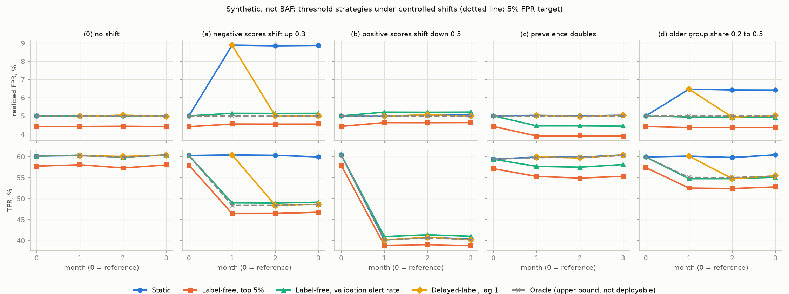

# Mechanism study (synthetic, not BAF)

Everything in this file is synthetic, not BAF. It explains how threshold strategies respond to different kinds of shift when the truth is known. It is not a result about BAF. Generated by `python -m src.synthetic`; no number here is typed by hand.

## Setup

Scores are normal with unit variance within each group and label. Reference month 0 (the validation month): younger group share 0.8, older 0.2; prevalence younger 0.009, older 0.018; negative score mean younger 0.0, older 0.4; positive score mean 2.0 in both groups. Each scenario applies one shift from month 1 onward and keeps it through month 3. 1,000,000 applications per month, seed 20261016 plus the scenario index. Strategies and threshold rules are those in PROTOCOL.md, with a 5% FPR target. Delayed-label lag 1 in month 1 uses month 0 and so equals static by construction.

## Accounting identity

For every row, realized FPR equals (alert share - TPR x prevalence) / (1 - prevalence), using the month's own prevalence. Largest absolute difference over all 95 rows: 1.39e-17.

## Which shifts recalibration fixes

| scenario | deployable strategies within 0.25 pt of budget in month 2 | static budget miss, pt, month 2 | oracle TPR % month 0 | oracle TPR % month 2 |
|---|---|---|---|---|
| (0) no shift | Static; Label-free, validation alert rate; Delayed-label, lag 1 | 0.01 | 60.2 | 59.9 |
| (a) negative scores shift up 0.3 | Label-free, validation alert rate; Delayed-label, lag 1 | 3.86 | 60.3 | 48.4 |
| (b) positive scores shift down 0.5 | Static; Label-free, validation alert rate; Delayed-label, lag 1 | 0.05 | 60.5 | 40.6 |
| (c) prevalence doubles | Static; Delayed-label, lag 1 | 0.0 | 59.4 | 59.9 |
| (d) older group share 0.2 to 0.5 | Label-free, validation alert rate; Delayed-label, lag 1 | 1.43 | 60.0 | 55.0 |

Reading. In (a) the negatives' scores move, and in (d) the mix of groups with different negative score distributions moves, so the static threshold overshoots the budget; label-free recalibration on the validation alert rate stays near budget, and delayed-label lag 1 returns near budget from the second shifted month. In (b) only the positives move: static stays on budget, and no threshold recovers the lost TPR, because the oracle loses the same TPR. In (c) only prevalence moves: static stays on budget, while both label-free strategies fall below budget because positives take a larger share of a fixed alert volume. Label-free top 5% is below budget in every scenario, including no shift, because by the identity above its FPR is below 5% whenever TPR is above 5%. In (a) the static TPR stays near its reference level only because it overshoots the FPR budget.

## Months 1 and 2 by scenario and strategy

| scenario | month | strategy | realized FPR % | budget miss, pt | TPR % | alert share % | FPR ratio | older share of alerts % | older share of applications % |
|---|---|---|---|---|---|---|---|---|---|
| (0) no shift | 1 | Static | 4.97 | -0.03 | 60.3 | 5.57 | 0.449 | 35.3 | 20.0 |
| (0) no shift | 1 | Label-free, top 5% | 4.42 | -0.58 | 58.1 | 5.0 | 0.44 | 35.7 | 20.0 |
| (0) no shift | 1 | Label-free, validation alert rate | 5.0 | 0.0 | 60.4 | 5.6 | 0.45 | 35.2 | 20.0 |
| (0) no shift | 1 | Delayed-label, lag 1 | 4.97 | -0.03 | 60.3 | 5.57 | 0.449 | 35.3 | 20.0 |
| (0) no shift | 1 | Oracle (upper bound, not deployable) | 5.0 | -0.0 | 60.4 | 5.6 | 0.45 | 35.2 | 20.0 |
| (0) no shift | 2 | Static | 5.01 | 0.01 | 59.9 | 5.6 | 0.455 | 35.0 | 20.0 |
| (0) no shift | 2 | Label-free, top 5% | 4.43 | -0.57 | 57.3 | 5.0 | 0.447 | 35.3 | 20.0 |
| (0) no shift | 2 | Label-free, validation alert rate | 5.01 | 0.01 | 59.9 | 5.6 | 0.455 | 35.0 | 20.0 |
| (0) no shift | 2 | Delayed-label, lag 1 | 5.04 | 0.04 | 60.1 | 5.63 | 0.455 | 35.0 | 20.0 |
| (0) no shift | 2 | Oracle (upper bound, not deployable) | 5.0 | -0.0 | 59.9 | 5.59 | 0.455 | 35.0 | 20.0 |
| (a) negative scores shift up 0.3 | 1 | Static | 8.89 | 3.89 | 60.4 | 9.44 | 0.497 | 33.3 | 20.0 |
| (a) negative scores shift up 0.3 | 1 | Label-free, top 5% | 4.55 | -0.45 | 46.5 | 5.0 | 0.443 | 35.6 | 20.0 |
| (a) negative scores shift up 0.3 | 1 | Label-free, validation alert rate | 5.14 | 0.14 | 49.0 | 5.61 | 0.45 | 35.3 | 20.0 |
| (a) negative scores shift up 0.3 | 1 | Delayed-label, lag 1 | 8.89 | 3.89 | 60.4 | 9.44 | 0.497 | 33.3 | 20.0 |
| (a) negative scores shift up 0.3 | 1 | Oracle (upper bound, not deployable) | 5.0 | -0.0 | 48.4 | 5.46 | 0.449 | 35.3 | 20.0 |
| (a) negative scores shift up 0.3 | 2 | Static | 8.86 | 3.86 | 60.3 | 9.41 | 0.493 | 33.6 | 20.1 |
| (a) negative scores shift up 0.3 | 2 | Label-free, top 5% | 4.55 | -0.45 | 46.5 | 5.0 | 0.437 | 36.1 | 20.1 |
| (a) negative scores shift up 0.3 | 2 | Label-free, validation alert rate | 5.14 | 0.14 | 49.0 | 5.61 | 0.447 | 35.6 | 20.1 |
| (a) negative scores shift up 0.3 | 2 | Delayed-label, lag 1 | 5.0 | -0.0 | 48.4 | 5.46 | 0.445 | 35.7 | 20.1 |
| (a) negative scores shift up 0.3 | 2 | Oracle (upper bound, not deployable) | 5.0 | -0.0 | 48.4 | 5.47 | 0.445 | 35.7 | 20.1 |
| (b) positive scores shift down 0.5 | 1 | Static | 4.99 | -0.01 | 40.1 | 5.37 | 0.452 | 35.2 | 20.0 |
| (b) positive scores shift down 0.5 | 1 | Label-free, top 5% | 4.63 | -0.37 | 38.9 | 5.0 | 0.446 | 35.4 | 20.0 |
| (b) positive scores shift down 0.5 | 1 | Label-free, validation alert rate | 5.2 | 0.2 | 41.0 | 5.59 | 0.456 | 35.0 | 20.0 |
| (b) positive scores shift down 0.5 | 1 | Delayed-label, lag 1 | 4.99 | -0.01 | 40.1 | 5.37 | 0.452 | 35.2 | 20.0 |
| (b) positive scores shift down 0.5 | 1 | Oracle (upper bound, not deployable) | 5.0 | -0.0 | 40.2 | 5.38 | 0.452 | 35.2 | 20.0 |
| (b) positive scores shift down 0.5 | 2 | Static | 5.05 | 0.05 | 40.8 | 5.44 | 0.451 | 35.3 | 20.1 |
| (b) positive scores shift down 0.5 | 2 | Label-free, top 5% | 4.63 | -0.37 | 39.0 | 5.0 | 0.443 | 35.7 | 20.1 |
| (b) positive scores shift down 0.5 | 2 | Label-free, validation alert rate | 5.2 | 0.2 | 41.4 | 5.59 | 0.453 | 35.2 | 20.1 |
| (b) positive scores shift down 0.5 | 2 | Delayed-label, lag 1 | 5.05 | 0.05 | 40.8 | 5.44 | 0.451 | 35.3 | 20.1 |
| (b) positive scores shift down 0.5 | 2 | Oracle (upper bound, not deployable) | 5.0 | -0.0 | 40.6 | 5.39 | 0.45 | 35.4 | 20.1 |
| (c) prevalence doubles | 1 | Static | 5.03 | 0.03 | 59.9 | 6.21 | 0.448 | 35.0 | 20.0 |
| (c) prevalence doubles | 1 | Label-free, top 5% | 3.89 | -1.11 | 55.3 | 5.0 | 0.427 | 35.7 | 20.0 |
| (c) prevalence doubles | 1 | Label-free, validation alert rate | 4.45 | -0.55 | 57.7 | 5.6 | 0.44 | 35.3 | 20.0 |
| (c) prevalence doubles | 1 | Delayed-label, lag 1 | 5.03 | 0.03 | 59.9 | 6.21 | 0.448 | 35.0 | 20.0 |
| (c) prevalence doubles | 1 | Oracle (upper bound, not deployable) | 5.0 | -0.0 | 59.8 | 6.18 | 0.448 | 35.0 | 20.0 |
| (c) prevalence doubles | 2 | Static | 5.0 | 0.0 | 59.9 | 6.19 | 0.453 | 34.7 | 19.9 |
| (c) prevalence doubles | 2 | Label-free, top 5% | 3.9 | -1.1 | 54.9 | 5.0 | 0.437 | 35.3 | 19.9 |
| (c) prevalence doubles | 2 | Label-free, validation alert rate | 4.45 | -0.55 | 57.5 | 5.6 | 0.444 | 35.1 | 19.9 |
| (c) prevalence doubles | 2 | Delayed-label, lag 1 | 4.97 | -0.03 | 59.7 | 6.15 | 0.452 | 34.8 | 19.9 |
| (c) prevalence doubles | 2 | Oracle (upper bound, not deployable) | 5.0 | -0.0 | 59.9 | 6.18 | 0.453 | 34.7 | 19.9 |
| (d) older group share 0.2 to 0.5 | 1 | Static | 6.47 | 1.47 | 60.1 | 7.19 | 0.446 | 68.7 | 50.0 |
| (d) older group share 0.2 to 0.5 | 1 | Label-free, top 5% | 4.36 | -0.64 | 52.5 | 5.0 | 0.417 | 69.9 | 50.0 |
| (d) older group share 0.2 to 0.5 | 1 | Label-free, validation alert rate | 4.94 | -0.06 | 54.8 | 5.6 | 0.427 | 69.5 | 50.0 |
| (d) older group share 0.2 to 0.5 | 1 | Delayed-label, lag 1 | 6.47 | 1.47 | 60.1 | 7.19 | 0.446 | 68.7 | 50.0 |
| (d) older group share 0.2 to 0.5 | 1 | Oracle (upper bound, not deployable) | 5.0 | -0.0 | 55.1 | 5.67 | 0.428 | 69.4 | 50.0 |
| (d) older group share 0.2 to 0.5 | 2 | Static | 6.43 | 1.43 | 59.8 | 7.15 | 0.453 | 68.4 | 50.0 |
| (d) older group share 0.2 to 0.5 | 2 | Label-free, top 5% | 4.35 | -0.65 | 52.4 | 5.0 | 0.423 | 69.6 | 50.0 |
| (d) older group share 0.2 to 0.5 | 2 | Label-free, validation alert rate | 4.93 | -0.07 | 54.8 | 5.6 | 0.432 | 69.2 | 50.0 |
| (d) older group share 0.2 to 0.5 | 2 | Delayed-label, lag 1 | 4.93 | -0.07 | 54.8 | 5.61 | 0.432 | 69.2 | 50.0 |
| (d) older group share 0.2 to 0.5 | 2 | Oracle (upper bound, not deployable) | 5.0 | -0.0 | 55.0 | 5.68 | 0.434 | 69.2 | 50.0 |

